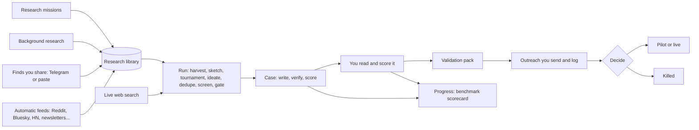

# PitchLab

PitchLab finds ideas for small, mostly automated software businesses, for business buyers or for consumers, that are
not generic, starting from real complaints and demand it finds on the web and in its own research library. It turns
the best ones into business cases backed by evidence: sources you can click, numbers worked out by code from stated
inputs, competitors that were checked, and a pitch. Then it helps
you test a case with real buyers. It writes a validation pack (a plan, prospects and outreach drafts that you send
yourself) and a landing page. It is built for one person, a solo founder or side-project builder, who wants a steady
supply of ideas worth pitching and an honest way to kill the weak ones. It runs as a private web dashboard plus a
background worker on your own computer.

## How PitchLab works, end to end

A recap of the whole path, in the order you meet it. Unfamiliar terms are explained in the
[glossary](docs/glossary.md). Numbers below are the code's defaults and limits at the time of writing.



### 1. Setup and what runs where

- **Two processes, one database.** `npm run web` starts the dashboard (Next.js, http://localhost:3000).
  `npm run worker` (`gen worker`) does all the paid work. Both use the Postgres in `DATABASE_URL`. The dashboard never
  calls a model: its buttons only queue rows that the worker picks up.
- **Keys** (in `.env`, see [Quick start](#quick-start)): `LLM_API_KEY` plus the two `LLM_*_BASE_URL` values are
  required for the worker. Optional: `GITHUB_TOKEN`, `STACKEXCHANGE_KEY`, `GOOGLE_PLACES_API_KEY`,
  `PRODUCTHUNT_TOKEN`, `YOUTUBE_API_KEY`, `TELEGRAM_BOT_TOKEN` (and `TELEGRAM_OWNER_CHAT_ID`), `SCRAPER_PROVIDER` with
  `SCRAPER_API_KEY`, `BLUESKY_HANDLE` with `BLUESKY_APP_PASSWORD`. The dashboard needs `OWNER_PASSWORD_HASH` and
  `SESSION_SECRET`.
- **When the worker starts** it runs the database migrations, seeds the defaults (market, lenses, settings) and makes
  sure the built-in example case exists. Every `gen` command that opens the database does the same.
- **Heartbeat.** Each loop the worker writes a heartbeat: which keys are set (yes or no, never the values) and the
  model for each stage. The **Command center** (Generator card) and **Settings** (Connections, Models per stage) show
  it. While a task runs, the heartbeat repeats every interval (default 10 s, `--interval`, minimum 2).
- **Order of work, oldest first in each queue:** queued runs, then validation jobs, then research missions. Only when
  all three are empty does it capture one queued find, top up background research (if on), run the automatic feeds when
  they are due, then sleep for the interval. With a Telegram bot token it also checks the bot for new links on every
  pass. The feeds step stops early when a run is queued. After each run it
  freezes any finished benchmark pass. Ctrl+C stops after the current task; a second Ctrl+C exits at once, and a run
  left `running` is recovered with `gen resume <runId>`. A mission still `running` after 2 hours is marked failed.
- **Queue caps:** at most 3 queued runs, 3 queued validation jobs and 3 queued owner research missions.

### 2. The research library

The **Library** page holds reusable public evidence that every run draws on: search and filters (kind, audience,
country, voice, source, age, status), one entry in full with its sources, a **Coverage** card, and the **Research
missions** card.

- **Entry kinds collected:** `problem` (a pain someone describes, with persona and cost or workaround), `pricing`
  (product, price points, buyer, complaints) and `startup` (name, what it does, business model, outcome such as active
  or dead, and why). Each entry has a voice: `operator` (someone living the problem), `neutral` (regulators,
  journalists, statistics) or `vendor` (someone selling a fix). Three more kinds say what is changing and how big the
  market is: `trend` (a topic that is rising, falling or steady, with the numbers), `rule_change` (a new or proposed
  rule: what changed, who must act, effective and published dates) and `market` (a segment and country with size and
  growth clues). Ideation reads them as demand evidence (see below).
- **Start a mission:** **Start research mission** on the Library page, or `gen research "<topic>"` (`--kinds`, up to 6
  of problem, pricing, startup, trend, rule_change, market, default the first three; `--countries CA,US` or `global`, up to 10; `--audience
  business|consumer|both`; `--budget`). `gen research status` lists recent missions.
- **Budget:** default $2, minimum $0.50, maximum $25. It is a soft limit, checked between steps: a mission stops
  starting new steps once spent, and the step in flight may run a little over. More budget buys more queries: about
  6 per dollar, 12 to 60.
- **What a mission does:**
  1. **Plan:** the model writes queries for the sources that can feed the chosen kinds. With `pricing`, at least
     max(2, 25% of web queries) aim at pricing pages; code adds them if the plan lacks them.
  2. **Free sources first:** Hacker News, Stack Exchange, GitHub, app store reviews, Product Hunt, YouTube comments (only
     with `YOUTUBE_API_KEY`) and the Y Combinator company list cost no model budget, so they run before any web search.
  3. **Web search, capped:** pricing-page queries first, then the rest. Each query does up to 3 model web searches and
     fetches up to 5 cited pages, obeying robots.txt (a setting) and refusing banned domains on every redirect. A page
     that blocks bots goes through the steps under **Getting past blocks** below; a page that is gone, down
     or too slow is tried once from the Internet Archive (an **archived copy** no more than 3 years old, marked as such
     on the entry), and a page with almost no text can be rendered in an optional local browser. Web collection
     stops once the mission has spent **60% of its budget**; the rest pays for extraction.
  4. **Extract:** the model turns fetched text into entries, 8 sources per batch, at most 3 entries per source per
     batch. Entries that fail their kind's schema are dropped. Product Hunt, YC and paid App Store prices become
     entries in code, with no model call.
  5. **Verify quotes:** a quote counts as verified only if it is at least **6 words and 30 characters** and appears
     **verbatim** (after normalising spaces and case) in the text the collector actually fetched.
  6. **Privacy scrub:** usernames, handles, emails and profile links are removed from stored text, and quotes are capped
     at 500 characters. A verified quote must still be long enough with the redaction markers taken out.
  7. **Embed and store:** one embedding call, then each entry is added, or merged into an existing entry when it is an
     exact copy or at least 0.9 similar (same kind). A merge adds the new source and can upgrade the voice or adopt a
     verified quote.
- **Sources for what is changing (free, no keys):**

  | Source | Feeds | What it gives |
  |---|---|---|
  | Federal Register (`federalregister.gov` API) | `rule_change` | US final and proposed rules from the last 24 months, with effective and published dates |
  | Wikipedia pageviews (Wikimedia API) | `trend` | Monthly views by people (not bots) over 36 months, measured in code: rising, falling or steady |
  | Hacker News yearly counts (Algolia) | `trend` | Stories per year over 4 years, measured in code |
  | World Bank indicators | `market` | Per country: population, GDP per capita, internet users, mobile subscriptions, new business density, urban share |

  Web search also feeds all three kinds, so Canadian and provincial rule changes (Canada Gazette, provincial registries)
  and segment market sizes come from web pages with verified quotes. Wikipedia, Hacker News and World Bank figures are
  numbers fetched by code and need no model call; a **reported** trend or market number is kept only when it appears in
  the verified quote. Per mission, at most 6 Wikipedia queries, 6 Hacker News trend queries and 8 Federal Register
  queries run, and World Bank runs once for each named country (not `global`) when `market` is chosen. A 429 stops that
  source for the mission with a warning. Rule changes published over 3 years ago, or in force over 2 years ago, are
  dropped with a count in the mission warnings. Background research adds one of these three kinds to each topic in turn.
- **Terms of service:** you lifted the terms-of-service bans on 2026-11-08 for this private prototype, so Reddit, G2,
  Capterra, Trustpilot, LinkedIn, Upwork and Indeed pages are allowed. Only Bing result pages stay banned (a search page
  is not a source), and your pilot site is **never** fetched, whatever the settings. Reddit comes in through the
  automatic feeds, not missions. Product Hunt is used only when `PRODUCTHUNT_TOKEN` is set (non-commercial use under
  its free API terms).
- **YouTube (optional):** with `YOUTUBE_API_KEY` set, missions also read public YouTube comments through the official API
  (a free key; at most 5 searches per mission, and PitchLab stops at 90 searches or 9,000 quota units per Pacific day).
  No channel or author names are stored, and the URL is the plain video URL. **YouTube comments and video text are kept
  for 30 days, then deleted** (the entry they supported is removed if nothing else backs it). Every copy of the text in
  runs and cases (signals, claim quotes, evidence and number-input quotes) is replaced by "[expired YouTube data]" once its
  library source has expired, and at most 30 days after the case was written; the case's own wording and numbers stay.
  Without the key, YouTube is skipped.
- **Archive fallback:** after a direct fetch fails with 403, 404, 410, a 5xx error or a timeout (and after the other
  steps for a blocked page), and only if robots.txt allowed the page, PitchLab asks the Internet Archive (Wayback
  Machine) for a snapshot, at most 1 request per second. A 429 from the archive turns it off for the rest of that
  mission.
- **Local browser (optional):** pages that fetch fine but hold under 800 readable characters (usually pages that need
  JavaScript) can be rendered in a local Chromium. Install it once with `npx playwright-core install chromium`, run in
  `packages/core` (about 150 to 300 MB). It identifies itself as PitchLab, sends GET requests only, blocks images, media
  and fonts, waits at most 20 seconds, and can only reach the network through a local guard that refuses private
  addresses. Without it, missions run as before. Settings → Connections shows whether it is installed.
- **Getting past blocks:** when a site answers 403 or shows a bot check ("Just a moment",
  "verify you are human"), PitchLab tries, in order:
  1. **A real browser:** the same Chromium, but with a window, on a profile that keeps its cookies (`.data/fetch-profile`),
     one page at a time, 3 to 8 seconds per page, with the browser's own identity. Many checks clear on their own
     this way. It never fakes a fingerprint and never solves CAPTCHAs.
  2. **A scraping service (optional):** ScrapingBee, ZenRows or Apify, if you set `SCRAPER_PROVIDER` and
     `SCRAPER_API_KEY`. At most `fetch.scraperMonthlyPages` pages a month (default 900, which fits the free tiers).
     Without a key, or once the month's pages are used, this step is skipped and logged.
  3. **The Internet Archive**, as above.

  A page with little text but no block still uses only the hidden browser; it never opens the window or spends
  scraper pages. **robots.txt** is obeyed by default; set `fetch.respectRobots` to false to stop checking it (your pilot
  site and banned hosts stay refused either way).
- **Automatic feeds:** while the worker runs, every `feeds.everyHours` hours (default 6) it reads these sources about the
  market's sectors, your lenses and rising trends (10 to 20 topics a day) and turns what it finds into library entries,
  spending at most `feeds.dailyUsd` a day on extraction (default $2):

  | Source | What | Needs |
  |---|---|---|
  | Reddit | posts and top comments from searches and a rotating list of subreddits | nothing (public RSS feeds, 1 request per 6 s; Reddit refuses its .json to logged-out clients) |
  | Bluesky | posts matching the topics | nothing, unless the search asks for sign-in: then `BLUESKY_HANDLE` and an app password in `BLUESKY_APP_PASSWORD` |
  | Hacker News | new Show HN and Ask HN posts | nothing |
  | arXiv | new papers | nothing |
  | Hugging Face | trending models and spaces | nothing |
  | GitHub | trending repositories | nothing |
  | Newsletters and launches | AlphaSignal, TLDR, Ben's Bites, Trends.vc, TechCrunch startups, Crunchbase News, BetaList, Indie Hackers (setting `feeds.rss`) | nothing |
  | YouTube Shorts | short videos and their comments | `YOUTUBE_API_KEY` |

  Each source keeps at most 200 items a run; a source that rate-limits or answers with the wrong kind of page stops for
  that run with a warning, and items already paid for are never paid for again. **Settings → Connections → Feeds**
  shows each source's last run, items, entries added and errors. `npm run gen -- feeds run` does one run now.
- **Finds:** links you share (Reels, TikToks, Shorts, posts, any web page) become library entries; see
  [Finds](#finds) below.
- **Settings without a screen:** `fetch.respectRobots`, `fetch.scraperMonthlyPages`, `feeds.everyHours`,
  `feeds.dailyUsd` and `feeds.rss` live in the database with no editing screen yet. Ask Claude to change them.
- **Fetch diagnostics:** every page fetch is logged by site and outcome (never the full URL). The Library page shows the
  last 30 days: success overall and by route, the sites that fail most and why, and the social share of sources.
- **Maintenance:** expired YouTube data, old fetch logs and old quota counters are cleaned up at the start of every
  `gen` command, when the worker starts, and every 24 hours while it runs, so expired data goes even if the worker was
  off for a while.
- **Background research:** off by default. Turn it on in **Settings → Research** with a daily cap (default $5, 0 to 50,
  counted per Toronto day; it needs at least $1). When the worker is idle it queues one $1 mission at a time, rotating
  through a fixed list of 40 consumer, business, regional and new-tech topics; every 4th pick instead targets a country
  or industry the library lacks (not repeated within 7 days).
- **Reject:** open an entry and press **Reject** (reason optional); **Restore** undoes it. Rejected entries are never
  used by runs.
- **What runs use:** only active entries with a verified quote feed a run's evidence (`problem` and `pricing`, best 3
  per domain, with a small bonus for operator or neutral voice and a penalty for age over 2 years). Startup and pricing
  entries feed ideate and the gate as context.
- **Source strength:** every entry has an assessment: how direct the source is (first hand, customer review, vendor,
  press, aggregate, official), its bias, a **strength** from 1 to 5 computed in code (start 3; operator or customer
  voice +1, vendor −1, verified quote +1, other independent sites saying the same +1 at 2 or more and +2 at 5 or more,
  older than 2 years −1, official source such as the Federal Register, World Bank or YC +1) and a one-sentence why.
  The Library page shows it as a badge, and ideation and the judge see it next to each entry. `gen library assess`
  fills it in for existing entries (cheap model, stops at `--max-usd`, default 5).
- **Company dossiers:** a worker job reads each startup's homepage, pricing page and one funding-or-shutdown search
  (dead companies also get a post-mortem search) and records who pays, the pricing unit and range, revenue drivers,
  acquisition, moat, use cases, why it worked or died, comps, funding and traction, each backed by a verified quote
  from a fetched page. Founder names are not stored. It spends at most `dossiers.dailyUsd` a day (default $2), yields
  to queued runs, and goes cited startups first, then those nearest this run's top sketches, then unknown business
  models. A page that never names the company is discarded (`dossierStatus: unmatched`). `gen dossiers run` runs it now.

#### Finds

A **find** is a link you share because the idea behind it looks good: an Instagram Reel, a TikTok, a YouTube Short, a
post, or any web page.

- **Sharing:** send links to your private **Telegram bot** from your phone (share → Telegram → your bot; any text after
  the link becomes your note), or paste them on **Library → Finds** (one link per line, a note after a space, up to 50
  at a time), or run `gen finds add <url> [note]`. The bot answers "Got it", or "Already captured" for a link you sent
  before, and "Captured: <title> — added to your library" once it is done. Only your chat can use the bot: it pairs
  with the one-time code shown in Settings → Connections (send `/start <code>`), ignores everyone else, and gets a new
  code after 10 wrong guesses. **Reset pairing** in Settings (or `gen telegram reset`) pairs it again.
- **Capture:** the worker downloads each link with free local tools installed by `npm run capture:setup`: the caption,
  views, likes and length, a speech transcript, and the text on screen. Instagram needs a throwaway account logged in
  once with `npm run capture:login`; TikTok and YouTube usually do not. A page that is not a video is read as a page.
  Videos are deleted after capture; only text and numbers are kept. One link at a time, at least 20 seconds apart for
  Instagram and TikTok.
- **What you get:** one library entry of kind `find` per link: what it is, who pays, how it earns, why it works, and the
  creator's claims (kept as unverified). Creator names are replaced by "the creator". A link that fails shows its error
  on the Finds page with a **Retry** button.
- **Ideas from finds:** every run shows the idea generator up to 6 finds under **Seen in the wild**, with the rule
  "do not copy it: make it 10x better, serve the people doing it, move it to a new market, or solve the harder problem
  underneath". **Start a run from these finds** on the Finds page (or `gen run --finds`) starts a run from your 10 most
  recent captured finds.
- YouTube links you share are your own finds, not YouTube API data, so they are **not** deleted after 30 days, and case
  quotes that cite them stay.

### 3. A run

Queue one on the **Runs** page (**Queue run**; ideas 1 to 30, default 12; cases 1 to 10, default 3) or execute one at
once in the terminal with `gen run --seed …` (`--ideas`, `--advance`). The Runs page History and the Command center
follow its progress.

- **Seeds:** `open` (6 random sectors of the market, at least 3 of them enterprise or mid-market when the market has tiers, plus 5 consumer segments picked for the run), `sector` (up to 8
  sectors you tick), `lens` (up to 8 idea patterns you tick), `idea` (your own idea, at least 50 characters; it always
  gets a case and the gate only advises). A gate-killed idea can be re-run with **Re-run as owner idea** on the Board.
- **Stages, in order:** harvest → sketch → archive → tournament → evolve → ideate → dedupe → screen → gate → case →
  verify → score (sketch, archive, tournament and evolve are the idea engine; see below). Each stage's output is
  saved, so `gen resume <runId>` restarts a failed run at the failed stage. A stage with nothing left to pass on skips
  the rest.
  - **harvest:** library signals first (up to 15 matching entries, or 7 once the library holds 50 or more eligible
    ones), then live research: one pain research call per sector (up to 8, 3 searches each), plus one pain call on the
    run's consumer segments for open seeds, plus opportunity calls (growth, spending and what is working) on top: 40%
    of the sector calls, rounded, at least 1 when there are 2 or more, aimed at the first sectors. Idea and lens seeds
    make one pain call. The free tech forums (Hacker News and Stack Exchange; GitHub and WordPress.org only when the
    setting `harvest.techForums` is on) are used when a software-adjacent sector or a lens seed is used. The model
    extracts pain or opportunity quotes and tags each one's voice; a quote is kept only if it appears in the fetched
    text.
  - **How ideas are made now (engine v2).** Instead of writing 12 full ideas straight from the signals, a run
    sketches wide, filters repeats, ranks the sketches head to head, improves the best, and only then writes full ideas:
    - **sketch** (prompt `sketch.v2`, model stage `sketch`, default `claude-sonnet-5-5`; v1 kept): one call per lens writes a
      long list of 20 titles, marks the near-duplicate or timid ones, and keeps 12 to 15 sketches, each pushed to be
      different and bolder. Each sketch is at most 600 characters, cites at least 1 harvest signal, and states why it is
      **not trivial** (the engineering, data or industry work a person or one prompt cannot do). The model sees an
      "avoid" list of up to 60 nearest earlier titles plus every title already sketched this run. About 90 sketches a run.
      Each sketch ends its problem with a "buyer pool" line whose source hint is a shown market entry or a signal url.
    - **archive** (code only): embeds the sketches and drops those at cosine 0.85 or more to an earlier sketch or idea,
      0.75 or more to a gate-killed idea or a case you killed, or 0.85 or more to another sketch this run. Survivors are
      filed into **diversity cells** (buyer kind × edge kind × business model). The unique share and the cells filled
      are stored on the run.
    - **tournament** (prompt `judge.v1`, model stage `judge`, default `gpt-6-sol`: a different family from the
      generator): 5 Swiss rounds (the first paired across cells), each pair judged twice with the order swapped, a split
      counts as a draw, Elo starts at 1200 with K = 24, at most 300 judge calls. The judge asks which business you would
      rather build, in this order: real need and willingness to pay, not trivial, earns rather than saves, a concrete
      edge against named incumbents, evidence strength. Up to 6 example pairs of cases you kept over cases you killed
      (from the training split only) are shown as "the owner kept X over Y because …". Pairing is seeded by the run id,
      so a resumed run replays the same pairs and does not pay for matches twice. If the judge errors, the match is a
      draw and is logged; if every call fails, the top 12 are picked by diversity cell and the run carries on.
    - **evolve** (prompt `evolve.v1`): for each of the top 6 sketches, takes its nearest 5 comps (startups with
      dossiers) and writes one variant that sharpens the wedge against them, combines it with another top sketch, or
      simplifies it to its hardest core. A variant keeps its parent's signals and lineage. The 12 parents and 6 variants
      then play 3 more rounds (at most 120 calls); the top 12 by Elo, with at most 2 per diversity cell and 2 per
      business model, go to ideate.
    - **cost:** sketch, tournament and evolve together aim at $8 a run or less (logged; the benchmark reports it).
    - **Engine flag:** the run config's `engine` is `v2` unless set to `v1`; an idea seed always uses v1 (one idea,
      nothing to sketch). If a v2 run ends up with no sketches, ideate falls back to v14 and says so on the run page.
  - **ideate** (prompt v16 on engine v2, which expands the chosen sketches into full ideas under the rules below and stores
    the sketch id and Elo; v14 on engine v1; v16 is v15 plus the consumer rule and the buyer floor rule: the gate kills an
    idea whose population has no source or is under 20,000 businesses or 1,000,000 individuals, and the source must be a
    shown market entry or a signal url from the run): open and sector seeds sample at most **6 lenses**, at least **2 ambition** lenses and no forced consumer quota (consumer lenses compete by weight; `money-leak`, `silent-failure`, `review-gap` and `platform-shockwave` are drawn at half weight, the ambition lenses and the new `industry-shift` at 1.5); lens seeds use exactly
    the lenses chosen. Each lens sees the signals, the run's focus (sectors, and consumer
    segments for open seeds) and library context: startups **already selling** nearby (up to 15), **lessons** from dead
    startups (up to 8) and **pricing** entries (up to 15), what is **changing** (up to 10 trends and rule changes, rule
    changes with an effective date within 18 months first) and **market size** entries (up to 6), plus past gate kills
    and ideas that already have cases. An idea cites a change or market in `libraryItemIds` only when it depends on it.
    Each idea names its audience, one of 11 business models, revenue mechanics, value to the user per year, a price
    hint, barriers to start and to copy (1 to 5) and the incumbents it claims to beat. It also states its **edge**
    (kind: AI, cost, speed, accuracy, data, network, new capability or distribution; the claim, what it beats and why
    now) and its **scale**: an estimate of the realistic paying buyers (a population times the share with the problem, the
    share willing to pay and the share reachable, each with a basis or source) and the price, from which code works out
    the revenue ceiling. For ads and affiliate ideas the third share is the share who become regular users and the price
    is our revenue per user per year. An idea is stored only when its evidence passes one of two
    routes: 3 operator or neutral complaint signals from 3 domains, or 1 such complaint plus 1 **demand source** (a
    cited library trend, market, rule change or pricing entry it was shown, or an opportunity signal from another
    domain than the complaint). Consumer ideas are only allowed when the buyer pool is at least 1M individuals with a cited source. The run must reach at least
    **4 business models**; if it falls short on the mix, or on the idea count, ideate asks once more
    (mix gaps plus a count top-up, up to 6 extra ideas), never in a loop. Calls ask for 3 ideas at a time, and drops are
    logged with a reason (field path and zod code, never model content). A value or price whose source is not a library entry or signal shown to the model loses the source
    and its basis is labelled **"Assumption:"**.
  - **dedupe:** embeds each idea and marks copies (similarity 0.88 or more) of an idea from any earlier run or one
    already kept in this run. Owner ideas are always kept.
  - **screen** (prompt v6): the model scores 7 criteria, plus **edge** (1 to 5) when the idea states one; code adds
    four scores it cannot override: the **money case**
    (from the value multiple: 10× or more scores 5, 5× 4, 3× 3, 1.5× 2, less 1; unknown 2; ads and affiliate, where
    the user pays nothing, a neutral 3), the **barrier** score (easy to start and hard to copy score high), **scale**
    (the band of the revenue ceiling, computed from the stored estimate; 2 when the ceiling is unknown, and at most 3
    when the population has no source or every step is an assumption) and **upside** (earn 5, time 3, risk 3, save 2).
    The total is a weighted mean: every value weighs 1 except speed (0.5). An old idea with no edge or estimate counts
    as 2 on each (upside 3). The top ideas advance, skipping any that has
    too little evidence for the gate (the gate's own evidence rule, applied early), a third idea with the same business
    model (cap of 2 per model), a near-twin of an advancing idea, a copy of an idea that has a case, or one close to a
    past gate kill. It also skips any that would fail the gate's **buyer floor** (no estimate, no source for the
    population, or under the floor), so the places go to ideas that can pass; the log counts them. If no consumer idea
    advanced, the best eligible one replaces the lowest business entrant. On
    engine v2 the screen also runs the idea reviewer (`idea-review.v2`) on the run's ideas and adds a review band to
    the total (top quartile +3, second +2, third +1); the tournament Elo is only a tiebreak. With no more generated
    ideas than places, there is no review (every eligible idea advances anyway). The 2026-11-11 judge
    calibration scored four judge variants 0.41-0.49 against the reviewer's 0.72 on the same 79 Board pairs.
  - **gate** (prompt v7): competitor research, then a different model judges six checks, harshly: **generic**
    (established competitors or library startups already provide the function and the idea has no concrete, checkable
    edge against named incumbents; a claimed gap that is only positioning does not count), **regulation** (needs a licence), **control** (depends on unofficial APIs, a partner or one
    platform), **autonomy** and **reachability** (buyers, or individuals through communities, search, app stores,
    content or partners, can be reached at scale). **Autonomy rule:** fail only when delivery is mostly human labour;
    pass when software-led with light setup or review, as a guide under about 2 hours per customer per month.
    **Evidence** is a code rule with ideate's two routes: at least 3 independent operator or neutral sources on
    distinct domains (up to 2 threads per community site; vendor and untagged sources never count), or 1 operator or
    neutral complaint plus 1 demand source. A code check, **scale**, fails a generated idea whose revenue ceiling is
    under $1M a year (setting `gate.minRevenueCeiling`); it passes with a note when there is no estimate or the price is
    unknown or 0 (a free product), and only advises for your own ideas. A code check, **buyers**, fails a generated idea whose buyer pool is under the floor: at least 20,000 businesses or 1,000,000 individuals, with a sourced population (settings `gate.minBuyers.businesses` and `gate.minBuyers.individuals`); with no source it fails, and for your own ideas it only advises (one with no estimate passes with a note). Sourced buyer counts come from `gen library seed-markets`. Any failure kills a generated idea. The new
    **trivial** check (model) kills a generated idea that a person with a spreadsheet, or one prompt to a frontier model
    given the data, would mostly deliver; it names the hard part or its absence, and only advises for your own ideas.
    **Comps** is a code verdict that never kills: it lists the idea's nearest library startups (dossier entries first)
    with who pays and the outcome, and flags "no comps found" or "only dead comps"; the case and the Board show it.
  - **case** (case-write v4): research, then write summary, evidence, numbers inputs, competitors and pitch. The model
    gives only inputs, each with a source or a stated assumption; code does all arithmetic with a formula per business
    model (for example subscription, take rate × GMV, impressions × CPM, referrals × commission, conversion × paid
    price) and shows the formula. The **value multiple** is value to the user per year over what the user pays per
    year; below 1× adds the **"value below price"** flag (the case is kept, you decide). Consumer pitch rule: for a
    consumer audience there are no cold emails; the pitch gives reach channels, landing-page copy and an interview
    script for people who opted in.
  - **verify:** fetches every cited page. A verbatim quote of at least 6 words and 30 characters is verified at once;
    otherwise a judge model decides (confident at 0.6 or more; 0.3 to 0.6, or an unconfirmed competitor fact, goes to
    you as "needs review"). Blocked or JavaScript-only pages are "unreachable".
  - **score:** the AI scores 7 criteria (pain, ROI, evidence, speed, autonomy, novelty, reach), 1 to 5 with a note.
    Evidence is capped by the share of verified claims (under 50%: at most 2; under 80%: at most 3).

### 4. Working a case

- **Board** (home page): columns New, Validating, Pilot, Live and Killed, plus the ideas the gate killed. Move a case
  with the stage control at the top of the case page. The **Leaderboard** ranks every case by AI and owner scores, and
  the **Command center** lists what needs you, spend and recent runs.
- **Tabs:** **Summary** (the case in brief, audience, business model, value, barriers, gate verdicts and flags, and
  "For you to check"), **Evidence** (signal quotes with links, and checked claims), **Numbers** (inputs with their sources or assumptions, formulas and
  results), **Competitors**, **Pitch** (emails, follow-ups and call script, or channels and landing copy for consumer
  cases), **Validate** (section 5) and **Score**.
- **Score tab:** the AI's scores (read-only) beside your own for the 7 criteria plus **"Your gut"**, each 1 to 5 with
  a note. Your gut score feeds the benchmark's owner verdict.
- **Export:** **Export Markdown** on the case page, or `gen export <slug>` / `gen export --all` to `output/cases/`.

### 5. Validation

- **Generate validation pack** on the Validate tab (it becomes **Run validation again** once a pack exists), or
  `gen validate <slug>`. About $0.60–1.50 per pack. Options: prospects to find (default 25, maximum 100), **Skip new
  prospect search** (`--skip-prospects`), **Refresh the pack documents** (`--refresh`), **Write the emails again**
  (`--redraft`). One live job per case; the example case is refused.
- **Sender identity first:** your name, mailing address and contact must be set in **Settings** (or `gen config set
  sender.name …`); until then the button is replaced by a link to Settings. Anti-spam law requires them in every
  email.
- **Steps:** pack documents (MVP spec, pilot plan, interview kit, go or kill checklist) → prospects (web research, or
  Google Places with `--source places`) → emails (an address found on the prospect's own site gets the CASL basis
  `self_published`; others are `third_party` or `unknown`) → drafts (a cold email and two follow-ups per prospect,
  `self_published` only unless `--include-weak`, with your sender footer and an unsubscribe line) → landing page →
  export to `output/validation/<slug>/`.
- **You send, you log.** PitchLab never sends email. After you send from your own mail program, record what happened
  under Drafts and tracking (**What happened**, then **Record**: sent, replied, positive, meeting, not interested,
  unsubscribe or note), or `gen outreach mark <prospect> <type>`. An unsubscribe is suppressed for good. The checklist
  tracks progress against the go or kill targets; `gen outreach status <slug>` prints it.
- **Consumer caveat:** do not generate a validation pack for a consumer case yet. Its drafts are still cold emails, and
  CASL does not allow cold email to individuals without consent. Consumer outreach rules come later (see
  [OWNER-TODO](docs/OWNER-TODO.md)).

### 6. Measuring quality

- **Progress** page: the idea-quality scorecard, with the canonical baseline (baseline-0, made once with
  `gen bench baseline` over your finished real runs) beside the 5 newest benchmark passes.
- **Scorecard metrics** (target in brackets): repetition (below 0.55), near-duplicates (below 10%), buyer variety (8 or
  more per run), consumer share (30% or more, consumer or both), consumer-only share (20% or less, `broad` market only; `both` not counted), business-model variety (4 or more per run), real-need evidence (50% or
  more), demand evidence (80% or more of ideas cite a trend, rule change or market entry), customer return (100%, median 3× or more), our margin (100%), wasted gate
  entrants (below 30%), easy to start and hard to copy (50% or more), owner verdict (3.5 or more, all scored), owner
  keeps (50% or more of the cases you decided on the Board), cost per case (tracked). The engine rows: unique sketch
  share (60% or more), diversity cells filled (8 or more per run), judge accuracy (70% or more at the latest
  calibration), trivial kill rate (reported), comps coverage (80% or more of cases with 2 or more dossier comps) and
  engine cost per run ($8 or less); runs from before the engine show "no data" for these. The diversity rows: top sector share (15% or less; each idea counts toward its run's focus sectors), enterprise and mid-market share (40% or more), buyer floor pass (100% of gate-passed ideas passed the `buyers` check, by construction, since the gate kills the rest) and buyer floor kill share (reported, no target: the share of generated ideas reaching the gate that failed the floor); these rows and consumer-only share show "no data" for passes run on a market other than `broad`. On `broad` passes the consumer share row notes that consumer-only share is the consumer goal there. Example runs and cases are always left out.
- **Benchmark passes:** **Run benchmark** on the Progress page (or `gen bench run`) queues the runs of the current
  benchmark, **bench-v3**: six runs (two open, two sector pairs in logistics, construction, healthcare and education,
  one pair of ambition lenses, one consumer and new-capability lens pair); about $30–50. **bench-v1** and **bench-v2**
  stay frozen so old passes remain comparable. It refuses while other runs are queued or a pass is running. The worker freezes the pass when its runs
  finish.
- **Recompute:** after you add gut scores to a pass's cases (listed under "Score these cases"), press **Recompute**
  under its column, or `gen bench report <passId> --recompute`, to freeze a new snapshot that includes them.
  `gen bench report` prints the scorecard and writes it to `output/bench/`.

#### What's new: rating ideas and the audit loop

- **Rate ideas.** On **Runs** (history), give each generated idea a thumbs up or down and optional tags (too niche, no
  edge, not scalable, boring, love it, would build and so on). Rate about 10 ideas per pass.
- **Idea review.** `gen audit review --last` (or with a pass id) has a second model score each idea 1–5 for scale,
  edge, novelty and niche, with reasons. Press **Recompute** on the pass afterwards to see the reviews and your
  ratings, since a pass snapshot is frozen. Once 10 or more ideas are rated, the scorecard shows how often it agrees with you.
- **Audit on Progress.** Under each finished pass, an **Audit** section shows where ideas came from (domains, vendor
  voice, lenses, what the gate killed) and flags a pass when one source or lens dominates or too many ideas are niche.
- **Holdout examples.** Write up to 10 ideas you would want in **Settings** (or `gen audit holdout add "..."`). The
  report shows how close the nearest generated idea is to each. They are never shown to the generator or the reviewer.
- **Edge and scale.** Ideas now say what gives them an edge (AI, cost, speed, accuracy, data, network, a new
  capability or distribution) against named incumbents, and how many buyers there are and why. The gate allows
  competition when the edge is concrete, and the screen scores edge and scale.
- **More ambition.** Six ambition lenses (AI replaces labour, 10x on an incumbent, new capability, marketplace, data
  flywheel, picks and shovels) get more of the lens slots, and research now looks for opportunity (growth, funding,
  new tools) as well as pain.
- **Tech forums are off by default.** WordPress and GitHub evidence is only collected when the setting
  `harvest.techForums` is on. Hacker News and Stack Exchange are unchanged.
- **Scale estimate and the $1M line.** Each idea now works out its realistic paying buyers (a population times the
  share with the problem, the share willing to pay and the share reachable) and a revenue ceiling (buyers times the yearly
  price). An unsourced share is capped, so a guess cannot inflate it. The gate stops a generated idea whose revenue
  ceiling is under $1M a year; the screen scores scale from the same number, in code. `gen audit scale --last` (or a pass
  id, or `--decided` for every case you kept or killed) fills in the estimate for older ideas.
- **Ads, free products and unsourced guesses.** For ads and affiliate ideas, where the user pays nothing, the third step
  of the estimate is the share who become regular users (unsourced caps: individuals 10%, businesses 30%) and the price
  is our revenue per user per year; the Summary tab and the idea text say "regular users". A price of 0 (a free
  product) leaves the revenue ceiling unknown: scale band 2, and the gate passes with a note. When the population has no
  source, or every step is an assumption, the scale band is capped at 3 (the ceiling and the gate are unaffected).
  The screen, the gate, the backtest and the Summary tab all read one `currentScale` that recomputes from the stored
  estimate, so an older stored result never shows a stale figure.
- **Earn over save.** Ideas are asked to prefer earning money for the buyer over saving them money. The screen scores
  this as upside (earn 5, time 3, risk 3, save 2) and the idea reviewer notes it.
- **The Board is the verdict.** Moving a case on the Board now counts as your verdict. The scorecard's **Owner keeps**
  is the share of the cases you decided (not New) that you kept (Validating, Pilot or Live), and **Reviewer agreement**
  counts kept as liked and killed as disliked, with idea ratings winning when both exist. The reviewer is now
  `idea-review.v2`: it scores scale on realistic paying buyers and the revenue ceiling.
- **Backtest.** `gen audit backtest` compares the scale and upside rule with your Board decisions and writes
  `output/audit/backtest-<date>.md`: the agreement, a table of kept and killed against above and below the line, and
  the cases where the rule and you disagree.
- **bench-v3** is the current benchmark (see above). Results are logged in
  [the idea quality log](docs/idea-quality-log.md).

### 7. Help

- **Take the tour** in the top bar replays the guided tour on the example case, whole or one chapter (welcome and
  setup, generate cases, the board, read a case, score it, validate, outreach, decide). It starts by itself on your
  first visit and never submits a paid form.
- **Help tips:** the small **?** next to a term opens a plain-language explanation; the same texts are in the
  [glossary](docs/glossary.md).
- **Docs:** [user guide](docs/user-guide.md), [architecture](docs/architecture.md),
  [dashboard and setup](docs/dashboard.md), and [OWNER-TODO](docs/OWNER-TODO.md) for actions only the owner can take.

## What you need

- **Node.js 22.12 or newer** (the CLI library requires it).
- **An LLM gateway and one API key.** The worker speaks two APIs with the same key: the Anthropic Messages API for
  Claude models (including the server-side web search tool) and the OpenAI Chat Completions API for the non-Claude
  judge models and embeddings. Set `LLM_ANTHROPIC_BASE_URL` and `LLM_OPENAI_BASE_URL`; change the model for any
  stage with `MODEL_OVERRIDES` (see [architecture](docs/architecture.md#llm-router-and-cost-logging)).
- **A Postgres database** that the dashboard and the worker share. A free Supabase project works, or the local
  Postgres in `docker-compose.yml`. The CLI alone can use a built-in embedded database (PGlite) with no setup.
- Optional: `GITHUB_TOKEN`, `STACKEXCHANGE_KEY` (more signal sources), `GOOGLE_PLACES_API_KEY` (a second prospect
  source) and `PRODUCTHUNT_TOKEN` (Product Hunt as a research-mission source) and `YOUTUBE_API_KEY` (YouTube comments as a
  research-mission source, and YouTube Shorts in the feeds).
- Optional, for finds: a Telegram bot token (`TELEGRAM_BOT_TOKEN`, free from @BotFather), the capture tools
  (`npm run capture:setup`, about 400 MB) and throwaway Instagram and TikTok accounts (`npm run capture:login`). Finds can
  also be pasted on the Finds page without Telegram.
- Optional, for blocked sites: a ScrapingBee, ZenRows or Apify key (`SCRAPER_PROVIDER`, `SCRAPER_API_KEY`). Optional for
  the feeds: a Bluesky app password (`BLUESKY_HANDLE`, `BLUESKY_APP_PASSWORD`), only if Bluesky search asks for sign-in.

## Quick start

```bash
git clone <repo-url> PitchLab
cd PitchLab
npm install
cp .env.example .env
```

Fill in `.env` (every variable is described in `.env.example` and in the [setup guide](docs/dashboard.md)):

- `DATABASE_URL`: your Postgres connection string. For Supabase use the session pooler string, and set
  `DATABASE_SSL_CA` ([steps](docs/dashboard.md#free-setup-supabase-database-app-on-your-pc-no-docker)).
- `LLM_API_KEY`, plus the two `LLM_*_BASE_URL` values for your gateway.
- `OWNER_PASSWORD_HASH`: run `npm run hash-password -w apps/web`, type a password of 12 or more characters, and
  paste it into `.env` as `OWNER_PASSWORD_HASH=<printed hash>`.
- `SESSION_SECRET`: paste the output of
  `node -e "console.log(require('crypto').randomBytes(32).toString('base64url'))"`.

Forgot your password? Run `npm run reset-password` in the repo folder, then restart the web app. It asks for a new
password (12 or more characters), updates `OWNER_PASSWORD_HASH` in `.env`, signs every device out by replacing
`SESSION_SECRET` (add `-- --keep-sessions` to keep them signed in), and keeps the old file as `.env.bak`.

Updating PitchLab: stop the web app, run `npm run gen -- runs` (or start the worker) once so the database is migrated,
then start the web app again (releases add migrations; the newest is 0015). A web app on an older database shows errors on every page.

Then:

```bash
npm run gen -- runs   # first time only: creates the tables and the built-in example case
npm run web           # terminal 1: the dashboard at http://localhost:3000
npm run worker        # terminal 2: does the work you queue; leave it running
```

Log in. The **Progress** page tracks idea quality: it compares each benchmark pass with your baseline (see "Track idea quality" in the user guide). A guided tour starts on your first visit and walks the whole path on the example case. Replay it, or one
chapter, with **Take the tour** in the top bar. Before you can generate a validation pack, fill in your sender details
in Settings (anti-spam law requires them in every email).

## The CLI in brief

Everything the dashboard queues can also be run directly. Use `npm run gen -- <command>` from the repo root.

| Command | What it does |
|---|---|
| `gen run --seed open` | One full run across every sector. `--seed sector --sectors "A,B"`, `--seed lens --lenses id1,id2` or `--seed idea --file idea.txt` narrow it. `--ideas` (default 12) and `--advance` (default 3) set the counts. |
| `gen validate <case-slug>` | Builds the validation pack and writes it to `output/validation/<slug>/`. `--skip-prospects` skips the paid prospect search; `--refresh` regenerates the pack and landing page; `--redraft` rewrites drafts for prospects you have not contacted. |
| `gen finds add <url> [note]` | Queues a link as a find (`gen finds list` shows them, `gen finds run` captures the queued ones now). `gen run --finds [ids...]` starts a run from your finds (default the 10 most recent captured). |
| `gen feeds run` | One automatic-feeds run now, within the daily cap; exits 1 when every source failed and nothing was added. |
| `gen telegram reset` | Forgets the Telegram bot's owner and prints a new pairing code (Settings → Connections has a **Reset pairing** button too). |
| `gen research "<topic>"` | Queues a research mission that adds to the library (the worker runs it). `--budget` (0.5–25, default 2), `--kinds`, `--countries`, `--audience`. `gen research status` lists recent missions. |
| `gen audit judge` | Calibrates the tournament judge on held-out pairs of cases you kept versus killed; writes `output/audit/judge-<date>.md` (costs model calls). |
| `gen dossiers run` | Builds the next company dossiers now, within the daily cap; `--limit`; an explicit `--max-usd` replaces the daily cap for that run (the backfill uses 15). |
| `gen library assess` | Rates the source strength of every library entry; `--max-usd` (default 5). |
| `gen library seed-markets` | Queues one `market` research mission (Canada and US) per sector of `--market` (default `broad`: 36 sectors) plus 3 individual-population missions (households, adults 18+, employed workers), so ideas have sourced buyer counts for the buyer floor. `--budget-usd` per mission (0.5–25, default 0.5; about $19.50 for `broad`), `--dry-run` lists them. Skips topics already queued, running or done; the worker runs them. |
| `gen runs` | Lists recent runs with status, stage, cost and cases. |
| `gen worker` | What `npm run worker` runs: executes queued runs, then validation packs, then research missions; when all are empty it captures finds, queues background research if that is on, and runs the feeds when due. `--once --feeds` also runs the feeds in a single pass. |
| `gen bench baseline` | Freezes today's idea-quality scorecard over your finished runs as the baseline to compare against. `--force` adds another; `--dry-run` prints it without saving. |
| `gen bench run` | Queues the 5 benchmark runs of bench-v2 (about $15–35 in model calls); the worker executes them. |
| `gen bench report [passId]` | Prints the scorecard and writes it to `output/bench/`. `--recompute` freezes a new snapshot of a pass with today's data first (the Progress page's Recompute button does the same). |

Also: `resume <runId>`, `export [slug] --all`, `outreach mark|status`, `prospects import`, `config set|get`.
`npm run gen -- <command> --help` shows every option.

## Costs

LLM spend is **notional**: PitchLab works it out from token counts and a price table
(`packages/core/src/config/prices.ts`). Your provider's invoice is the real figure.

| What | About |
|---|---|
| One run at the defaults (12 ideas, up to 3 cases) | $3–7. Real runs so far: $3.39–7.30 ([run notes](docs/runs/)). |
| One case for your own idea (or "Re-run as owner idea") | about $4 |
| One validation pack | $0.60–1.50, of which prospect search is about $0.45–0.60. "Skip new prospect search" (`--skip-prospects`) avoids that part. |
| One research mission | Up to its budget (default $2, $0.50–25). Background missions are $1 each, up to the daily cap (default $5). |
| One benchmark pass (bench-v2) | about $15–35 (5 runs) |
| The idea engine (sketch, tournament, evolve) | at most about $8 a run, inside the run's cost |
| Company dossiers | at most `dossiers.dailyUsd` a day (default $2); about $0.05 each |
| Source-strength and dossier backfills | once, each with its own `--max-usd` cap: assess $5 (default), dossiers $15; under $25 together |
| Automatic feeds | at most `feeds.dailyUsd` a day (default $2), extraction only; the sources themselves are free |
| One find | one small extraction call (cents); the capture tools are free and run on your computer |
| Scraping service | free within `fetch.scraperMonthlyPages` (default 900 pages a month, inside the free tiers) |
| Hosting | $0 with a free Supabase database and the app on your own computer |

Nothing spends money unless you press **Queue run**, **Generate validation pack**, **Start research mission**,
**Start a run from these finds** or **Run benchmark**, share or paste a find, turn on Background research, or run a
`gen` command yourself. The one exception is the automatic feeds: while the worker runs they spend up to
`feeds.dailyUsd` a day (default $2). The tour never submits those forms.

## Safety stance

- **Never sends email.** PitchLab drafts outreach; you send it from your own mail program. Each prospect's address
  records where it was found (its CASL basis, after Canada's anti-spam law). Addresses with a weak or unknown basis
  are left out by default. Every draft ends with your identity and an unsubscribe line, and unsubscribes are
  suppressed for good. This is not legal advice.
- **Treats web text as untrusted.** Anything fetched from the web or written by a model is neutralised before it goes
  into a prompt, and it is always shown as plain text, never as HTML.
- **Fetches pages carefully.** Only public internet addresses are fetched (no local or private networks), and every
  redirect is checked again. Blocked sites get a real browser and, if you add a key, a scraping service, but never a
  faked fingerprint or a solved CAPTCHA. Your pilot site is never fetched.
- **Captures links in a box.** The capture tools run with fixed arguments (no shell), time limits and a size cap; every
  download goes through the same address guard; videos are deleted afterwards; errors never show tokens, cookies or
  file paths. The Telegram bot answers only your chat.
- **Verifies database TLS.** Remote database connections use verified TLS, and no setting turns the check off.
- **Keeps the dashboard private.** One owner, a hashed password, a signed session cookie, a rate-limited login,
  origin checks on every form, and no secrets in the browser. The dashboard never calls an LLM itself.

The reasons behind each rule are in [architecture](docs/architecture.md#security-model).

## Documentation

- [User guide](docs/user-guide.md): the workflow step by step, how to judge a case and when to kill it.
- [Setup and operations](docs/dashboard.md): database options, environment variables, phone access, troubleshooting.
- [Architecture](docs/architecture.md): layout, pipeline, worker, data model, security model, tests.
- [Glossary](docs/glossary.md): every term the app uses.
- [Idea quality log](docs/idea-quality-log.md): what changed, what each pass measured and what to try next.
- [Owner to-do](docs/OWNER-TODO.md): actions only the owner can take.
- [Known limits and follow-ups](docs/plan-1-followups.md).
- [Project log](docs/CONTEXT.md): the internal working log of decisions and runs.

## Development

```bash
npm test -w packages/capture
npx tsc --noEmit -p packages/capture
npm test -w packages/core
npx tsc --noEmit -p packages/core
npm test -w apps/web
npm run typecheck -w apps/web
npm run build -w apps/web          # needs the web variables in .env (dummy values are fine)
npm run check-bundle -w apps/web   # after the build: no secrets in the browser bundle
```

See [testing and merge gates](docs/architecture.md#testing-and-merge-gates).

## Status

A solo side project for a single owner. It runs locally today; hosting is planned. There is no licence file yet, so
all rights are reserved until one is added.
