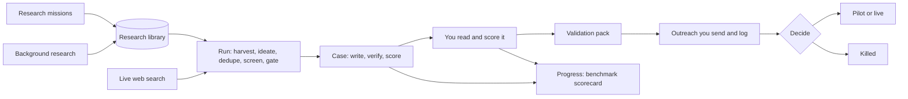

# PitchLab

PitchLab finds ideas for small, mostly automated software businesses, for business buyers or for consumers, that are
not generic, starting from real complaints and demand it finds on the web and in its own research library. It turns
the best ones into business cases backed by evidence: sources you can click, numbers worked out by code from stated
inputs, competitors that were checked, and a pitch. Then it helps
you test a case with real buyers. It writes a validation pack (a plan, prospects and outreach drafts that you send
yourself) and a landing page. It is built for one person, a solo founder or side-project builder, who wants a steady
supply of ideas worth pitching and an honest way to kill the weak ones. It runs as a private web dashboard plus a
background worker on your own computer.

## How PitchLab works, end to end

A recap of the whole path, in the order you meet it. Unfamiliar terms are explained in the
[glossary](docs/glossary.md). Numbers below are the code's defaults and limits at the time of writing.



### 1. Setup and what runs where

- **Two processes, one database.** `npm run web` starts the dashboard (Next.js, http://localhost:3000).
  `npm run worker` (`gen worker`) does all the paid work. Both use the Postgres in `DATABASE_URL`. The dashboard never
  calls a model: its buttons only queue rows that the worker picks up.
- **Keys** (in `.env`, see [Quick start](#quick-start)): `LLM_API_KEY` plus the two `LLM_*_BASE_URL` values are
  required for the worker. Optional: `GITHUB_TOKEN`, `STACKEXCHANGE_KEY`, `GOOGLE_PLACES_API_KEY`,
  `PRODUCTHUNT_TOKEN`, `YOUTUBE_API_KEY`. The dashboard needs `OWNER_PASSWORD_HASH` and `SESSION_SECRET`.
- **When the worker starts** it runs the database migrations, seeds the defaults (market, lenses, settings) and makes
  sure the built-in example case exists. Every `gen` command that opens the database does the same.
- **Heartbeat.** Each loop the worker writes a heartbeat: which keys are set (yes or no, never the values) and the
  model for each stage. The **Command center** (Generator card) and **Settings** (Connections, Models per stage) show
  it. While a task runs, the heartbeat repeats every interval (default 10 s, `--interval`, minimum 2).
- **Order of work, oldest first in each queue:** queued runs, then validation jobs, then research missions. Only when
  all three are empty does it top up background research (if on), then sleep for the interval. After each run it
  freezes any finished benchmark pass. Ctrl+C stops after the current task; a second Ctrl+C exits at once, and a run
  left `running` is recovered with `gen resume <runId>`. A mission still `running` after 2 hours is marked failed.
- **Queue caps:** at most 3 queued runs, 3 queued validation jobs and 3 queued owner research missions.

### 2. The research library

The **Library** page holds reusable public evidence that every run draws on: search and filters (kind, audience,
country, voice, source, age, status), one entry in full with its sources, a **Coverage** card, and the **Research
missions** card.

- **Entry kinds collected:** `problem` (a pain someone describes, with persona and cost or workaround), `pricing`
  (product, price points, buyer, complaints) and `startup` (name, what it does, business model, outcome such as active
  or dead, and why). Each entry has a voice: `operator` (someone living the problem), `neutral` (regulators,
  journalists, statistics) or `vendor` (someone selling a fix). Other kinds (trend, rule change, market) are defined
  for later and not collected yet.
- **Start a mission:** **Start research mission** on the Library page, or `gen research "<topic>"` (`--kinds`, up to 3
  of problem, pricing, startup, default all three; `--countries CA,US` or `global`, up to 10; `--audience
  business|consumer|both`; `--budget`). `gen research status` lists recent missions.
- **Budget:** default $2, minimum $0.50, maximum $25. It is a soft limit, checked between steps: a mission stops
  starting new steps once spent, and the step in flight may run a little over. More budget buys more queries: about
  6 per dollar, 12 to 60.
- **What a mission does:**
  1. **Plan:** the model writes queries for the sources that can feed the chosen kinds. With `pricing`, at least
     max(2, 25% of web queries) aim at pricing pages; code adds them if the plan lacks them.
  2. **Free sources first:** Hacker News, Stack Exchange, GitHub, app store reviews, Product Hunt, YouTube comments (only
     with `YOUTUBE_API_KEY`) and the Y Combinator company list cost no model budget, so they run before any web search.
  3. **Web search, capped:** pricing-page queries first, then the rest. Each query does up to 3 model web searches and
     fetches up to 5 cited pages, obeying robots.txt and refusing banned domains on every redirect. A page that comes
     back blocked, gone, down or too slow is tried once from the Internet Archive (an **archived copy** no more than
     3 years old, marked as such on the entry), and a page with almost no text can be rendered in an optional local
     browser. Web collection
     stops once the mission has spent **60% of its budget**; the rest pays for extraction.
  4. **Extract:** the model turns fetched text into entries, 8 sources per batch, at most 3 entries per source per
     batch. Entries that fail their kind's schema are dropped. Product Hunt, YC and paid App Store prices become
     entries in code, with no model call.
  5. **Verify quotes:** a quote counts as verified only if it is at least **6 words and 30 characters** and appears
     **verbatim** (after normalising spaces and case) in the text the collector actually fetched.
  6. **Privacy scrub:** usernames, handles, emails and profile links are removed from stored text, and quotes are capped
     at 500 characters. A verified quote must still be long enough with the redaction markers taken out.
  7. **Embed and store:** one embedding call, then each entry is added, or merged into an existing entry when it is an
     exact copy or at least 0.9 similar (same kind). A merge adds the new source and can upgrade the voice or adopt a
     verified quote.
- **Sources not used:** Reddit is deliberately off (its terms need a contract for commercial use and its public API is
  closing; the collector code stays unused). Product Hunt is used only when `PRODUCTHUNT_TOKEN` is set (non-commercial
  use under its free API terms).
- **YouTube (optional):** with `YOUTUBE_API_KEY` set, missions also read public YouTube comments through the official API
  (a free key; at most 5 searches per mission, and PitchLab stops at 90 searches or 9,000 quota units per Pacific day).
  No channel or author names are stored, and the URL is the plain video URL. **YouTube comments and video text are kept
  for 30 days, then deleted** (the entry they supported is removed if nothing else backs it). Every copy of the text in
  runs and cases (signals, claim quotes, evidence and number-input quotes) is replaced by "[expired YouTube data]" once its
  library source has expired, and at most 30 days after the case was written; the case's own wording and numbers stay.
  Without the key, YouTube is skipped.
- **Archive fallback:** after a direct fetch fails with 403, 404, 410, a 5xx error or a timeout, and only if robots.txt
  allowed the page, PitchLab asks the Internet Archive (Wayback Machine) for a snapshot, at most 1 request per second. A
  429 from the archive turns it off for the rest of that mission.
- **Local browser (optional):** pages that fetch fine but hold under 800 readable characters (usually pages that need
  JavaScript) can be rendered in a local Chromium. Install it once with `npx playwright-core install chromium`, run in
  `packages/core` (about 150 to 300 MB). It identifies itself as PitchLab, sends GET requests only, blocks images, media
  and fonts, waits at most 20 seconds, and can only reach the network through a local guard that refuses private
  addresses. Without it, missions run as before. Settings → Connections shows whether it is installed.
- **Fetch diagnostics:** every page fetch is logged by site and outcome (never the full URL). The Library page shows the
  last 30 days: success overall and by route, the sites that fail most and why, and the social share of sources.
- **Maintenance:** expired YouTube data, old fetch logs and old quota counters are cleaned up at the start of every
  `gen` command, when the worker starts, and every 24 hours while it runs, so expired data goes even if the worker was
  off for a while.
- **Background research:** off by default. Turn it on in **Settings → Research** with a daily cap (default $5, 0 to 50,
  counted per Toronto day; it needs at least $1). When the worker is idle it queues one $1 mission at a time, rotating
  through a fixed list of 40 consumer, business, regional and new-tech topics; every 4th pick instead targets a country
  or industry the library lacks (not repeated within 7 days).
- **Reject:** open an entry and press **Reject** (reason optional); **Restore** undoes it. Rejected entries are never
  used by runs.
- **What runs use:** only active entries with a verified quote feed a run's evidence (`problem` and `pricing`, best 3
  per domain, with a small bonus for operator or neutral voice and a penalty for age over 2 years). Startup and pricing
  entries feed ideate and the gate as context.

### 3. A run

Queue one on the **Runs** page (**Queue run**; ideas 1 to 30, default 12; cases 1 to 10, default 3) or execute one at
once in the terminal with `gen run --seed …` (`--ideas`, `--advance`). The Runs page History and the Command center
follow its progress.

- **Seeds:** `open` (6 random sectors of the market plus 5 consumer segments picked for the run), `sector` (up to 8
  sectors you tick), `lens` (up to 8 idea patterns you tick), `idea` (your own idea, at least 50 characters; it always
  gets a case and the gate only advises). A gate-killed idea can be re-run with **Re-run as owner idea** on the Board.
- **Stages, in order:** harvest → ideate → dedupe → screen → gate → case → verify → score. Each stage's output is
  saved, so `gen resume <runId>` restarts a failed run at the failed stage. A stage with nothing left to pass on skips
  the rest.
  - **harvest:** library signals first (up to 15 matching entries, or 7 once the library holds 50 or more eligible
    ones), then live research: one web research call per sector (up to 8, 3 searches each), plus one call on the run's
    consumer segments for open seeds, plus the free tech forums (Hacker News, Stack Exchange, GitHub, WordPress.org)
    when a software-adjacent sector or a lens seed is used. The model extracts pain quotes and tags each one's voice;
    a quote is kept only if it appears in the fetched text.
  - **ideate** (prompt v8): open and sector seeds sample at most **6 lenses**, at least **2 of them consumer** lenses;
    lens seeds use exactly the lenses chosen. Each lens sees the signals, the run's focus (sectors, and consumer
    segments for open seeds) and library context: startups **already selling** nearby (up to 15), **lessons** from dead
    startups (up to 8) and **pricing** entries (up to 15), plus past gate kills and ideas that already have cases.
    Each idea names its audience, one of 11 business models, revenue mechanics, value to the user per year, a price
    hint, barriers to start and to copy (1 to 5) and the incumbents it claims to beat. The run must reach at least
    **30% consumer** ideas and **4 business models**; if it falls short, ideate asks once more (up to 6 extra ideas),
    never in a loop. A value or price whose source is not a library entry or signal shown to the model loses the source
    and its basis is labelled **"Assumption:"**.
  - **dedupe:** embeds each idea and marks copies (similarity 0.88 or more) of an idea from any earlier run or one
    already kept in this run. Owner ideas are always kept.
  - **screen** (prompt v4): the model scores 7 criteria; code adds two scores it cannot override, the **money case**
    (from the value multiple: 10× or more scores 5, 5× 4, 3× 3, 1.5× 2, less 1; unknown 2; ads and affiliate, where
    the user pays nothing, a neutral 3) and the **barrier** score (easy to start and hard to copy score high). The total
    is the mean of the 7 criteria, novelty again, money case and barrier. The top ideas advance, skipping any that has
    too little evidence for the gate (the gate's own evidence rule, applied early), a third idea with the same business
    model (cap of 2 per model), a near-twin of an advancing idea, a copy of an idea that has a case, or one close to a
    past gate kill. If no consumer idea advanced, the best eligible one replaces the lowest business entrant.
  - **gate** (prompt v3): competitor research, then a different model judges five checks, harshly: **generic**
    (established competitors or library startups already provide the function; a claimed gap that is only positioning
    does not count), **regulation** (needs a licence), **control** (depends on unofficial APIs, a partner or one
    platform), **autonomy** and **reachability** (buyers, or individuals through communities, search, app stores,
    content or partners, can be reached at scale). **Autonomy rule:** fail only when delivery is mostly human labour;
    pass when software-led with light setup or review, as a guide under about 2 hours per customer per month.
    **Evidence** is a code rule: at least 3 independent operator or neutral sources on distinct domains (up to 2
    threads per community site; vendor and untagged sources never count). Any failure kills a generated idea.
  - **case** (case-write v4): research, then write summary, evidence, numbers inputs, competitors and pitch. The model
    gives only inputs, each with a source or a stated assumption; code does all arithmetic with a formula per business
    model (for example subscription, take rate × GMV, impressions × CPM, referrals × commission, conversion × paid
    price) and shows the formula. The **value multiple** is value to the user per year over what the user pays per
    year; below 1× adds the **"value below price"** flag (the case is kept, you decide). Consumer pitch rule: for a
    consumer audience there are no cold emails; the pitch gives reach channels, landing-page copy and an interview
    script for people who opted in.
  - **verify:** fetches every cited page. A verbatim quote of at least 6 words and 30 characters is verified at once;
    otherwise a judge model decides (confident at 0.6 or more; 0.3 to 0.6, or an unconfirmed competitor fact, goes to
    you as "needs review"). Blocked or JavaScript-only pages are "unreachable".
  - **score:** the AI scores 7 criteria (pain, ROI, evidence, speed, autonomy, novelty, reach), 1 to 5 with a note.
    Evidence is capped by the share of verified claims (under 50%: at most 2; under 80%: at most 3).

### 4. Working a case

- **Board** (home page): columns New, Validating, Pilot, Live and Killed, plus the ideas the gate killed. Move a case
  with the stage control at the top of the case page. The **Leaderboard** ranks every case by AI and owner scores, and
  the **Command center** lists what needs you, spend and recent runs.
- **Tabs:** **Summary** (the case in brief, audience, business model, value, barriers, gate verdicts and flags, and
  "For you to check"), **Evidence** (signal quotes with links, and checked claims), **Numbers** (inputs with their sources or assumptions, formulas and
  results), **Competitors**, **Pitch** (emails, follow-ups and call script, or channels and landing copy for consumer
  cases), **Validate** (section 5) and **Score**.
- **Score tab:** the AI's scores (read-only) beside your own for the 7 criteria plus **"Your gut"**, each 1 to 5 with
  a note. Your gut score feeds the benchmark's owner verdict.
- **Export:** **Export Markdown** on the case page, or `gen export <slug>` / `gen export --all` to `output/cases/`.

### 5. Validation

- **Generate validation pack** on the Validate tab (it becomes **Run validation again** once a pack exists), or
  `gen validate <slug>`. About $0.60–1.50 per pack. Options: prospects to find (default 25, maximum 100), **Skip new
  prospect search** (`--skip-prospects`), **Refresh the pack documents** (`--refresh`), **Write the emails again**
  (`--redraft`). One live job per case; the example case is refused.
- **Sender identity first:** your name, mailing address and contact must be set in **Settings** (or `gen config set
  sender.name …`); until then the button is replaced by a link to Settings. Anti-spam law requires them in every
  email.
- **Steps:** pack documents (MVP spec, pilot plan, interview kit, go or kill checklist) → prospects (web research, or
  Google Places with `--source places`) → emails (an address found on the prospect's own site gets the CASL basis
  `self_published`; others are `third_party` or `unknown`) → drafts (a cold email and two follow-ups per prospect,
  `self_published` only unless `--include-weak`, with your sender footer and an unsubscribe line) → landing page →
  export to `output/validation/<slug>/`.
- **You send, you log.** PitchLab never sends email. After you send from your own mail program, record what happened
  under Drafts and tracking (**What happened**, then **Record**: sent, replied, positive, meeting, not interested,
  unsubscribe or note), or `gen outreach mark <prospect> <type>`. An unsubscribe is suppressed for good. The checklist
  tracks progress against the go or kill targets; `gen outreach status <slug>` prints it.
- **Consumer caveat:** do not generate a validation pack for a consumer case yet. Its drafts are still cold emails, and
  CASL does not allow cold email to individuals without consent. Consumer outreach rules come later (see
  [OWNER-TODO](docs/OWNER-TODO.md)).

### 6. Measuring quality

- **Progress** page: the idea-quality scorecard, with the canonical baseline (baseline-0, made once with
  `gen bench baseline` over your finished real runs) beside the 5 newest benchmark passes.
- **Scorecard metrics** (target in brackets): repetition (below 0.55), near-duplicates (below 10%), buyer variety (8 or
  more per run), consumer share (30% or more), business-model variety (4 or more per run), real-need evidence (50% or
  more), demand evidence (not measured yet), customer return (100%, median 3× or more), our margin (100%), wasted gate
  entrants (below 30%), easy to start and hard to copy (50% or more), owner verdict (3.5 or more, all scored), cost per
  case (tracked). Example runs and cases are always left out.
- **Benchmark passes:** **Run benchmark** on the Progress page (or `gen bench run`) queues the runs of the current
  benchmark, **bench-v2**: bench-v1's four seeds (open, two sector pairs, one lens pair) plus a consumer lens seed
  (earn on the side, save money automatically); about $15–35. **bench-v1** stays frozen so old passes remain
  comparable. It refuses while other runs are queued or a pass is running. The worker freezes the pass when its runs
  finish.
- **Recompute:** after you add gut scores to a pass's cases (listed under "Score these cases"), press **Recompute**
  under its column, or `gen bench report <passId> --recompute`, to freeze a new snapshot that includes them.
  `gen bench report` prints the scorecard and writes it to `output/bench/`.

### 7. Help

- **Take the tour** in the top bar replays the guided tour on the example case, whole or one chapter (welcome and
  setup, generate cases, the board, read a case, score it, validate, outreach, decide). It starts by itself on your
  first visit and never submits a paid form.
- **Help tips:** the small **?** next to a term opens a plain-language explanation; the same texts are in the
  [glossary](docs/glossary.md).
- **Docs:** [user guide](docs/user-guide.md), [architecture](docs/architecture.md),
  [dashboard and setup](docs/dashboard.md), and [OWNER-TODO](docs/OWNER-TODO.md) for actions only the owner can take.

## What you need

- **Node.js 22.12 or newer** (the CLI library requires it).
- **An LLM gateway and one API key.** The worker speaks two APIs with the same key: the Anthropic Messages API for
  Claude models (including the server-side web search tool) and the OpenAI Chat Completions API for the non-Claude
  judge models and embeddings. Set `LLM_ANTHROPIC_BASE_URL` and `LLM_OPENAI_BASE_URL`; change the model for any
  stage with `MODEL_OVERRIDES` (see [architecture](docs/architecture.md#llm-router-and-cost-logging)).
- **A Postgres database** that the dashboard and the worker share. A free Supabase project works, or the local
  Postgres in `docker-compose.yml`. The CLI alone can use a built-in embedded database (PGlite) with no setup.
- Optional: `GITHUB_TOKEN`, `STACKEXCHANGE_KEY` (more signal sources), `GOOGLE_PLACES_API_KEY` (a second prospect
  source) and `PRODUCTHUNT_TOKEN` (Product Hunt as a research-mission source) and `YOUTUBE_API_KEY` (YouTube comments as a
  research-mission source).

## Quick start

```bash
git clone <repo-url> PitchLab
cd PitchLab
npm install
cp .env.example .env
```

Fill in `.env` (every variable is described in `.env.example` and in the [setup guide](docs/dashboard.md)):

- `DATABASE_URL`: your Postgres connection string. For Supabase use the session pooler string, and set
  `DATABASE_SSL_CA` ([steps](docs/dashboard.md#free-setup-supabase-database-app-on-your-pc-no-docker)).
- `LLM_API_KEY`, plus the two `LLM_*_BASE_URL` values for your gateway.
- `OWNER_PASSWORD_HASH`: run `npm run hash-password -w apps/web`, type a password of 12 or more characters, and
  paste it into `.env` as `OWNER_PASSWORD_HASH=<printed hash>`.
- `SESSION_SECRET`: paste the output of
  `node -e "console.log(require('crypto').randomBytes(32).toString('base64url'))"`.

Updating PitchLab: stop the web app, run `npm run gen -- runs` (or start the worker) once so the database is migrated,
then start the web app again (releases add migrations; the newest is 0010). A web app on an older database shows errors on every page.

Then:

```bash
npm run gen -- runs   # first time only: creates the tables and the built-in example case
npm run web           # terminal 1: the dashboard at http://localhost:3000
npm run worker        # terminal 2: does the work you queue; leave it running
```

Log in. The **Progress** page tracks idea quality: it compares each benchmark pass with your baseline (see "Track idea quality" in the user guide). A guided tour starts on your first visit and walks the whole path on the example case. Replay it, or one
chapter, with **Take the tour** in the top bar. Before you can generate a validation pack, fill in your sender details
in Settings (anti-spam law requires them in every email).

## The CLI in brief

Everything the dashboard queues can also be run directly. Use `npm run gen -- <command>` from the repo root.

| Command | What it does |
|---|---|
| `gen run --seed open` | One full run across every sector. `--seed sector --sectors "A,B"`, `--seed lens --lenses id1,id2` or `--seed idea --file idea.txt` narrow it. `--ideas` (default 12) and `--advance` (default 3) set the counts. |
| `gen validate <case-slug>` | Builds the validation pack and writes it to `output/validation/<slug>/`. `--skip-prospects` skips the paid prospect search; `--refresh` regenerates the pack and landing page; `--redraft` rewrites drafts for prospects you have not contacted. |
| `gen research "<topic>"` | Queues a research mission that adds to the library (the worker runs it). `--budget` (0.5–25, default 2), `--kinds`, `--countries`, `--audience`. `gen research status` lists recent missions. |
| `gen runs` | Lists recent runs with status, stage, cost and cases. |
| `gen worker` | What `npm run worker` runs: executes queued runs, then validation packs, then research missions; when all are empty it queues background research if that is on. |
| `gen bench baseline` | Freezes today's idea-quality scorecard over your finished runs as the baseline to compare against. `--force` adds another; `--dry-run` prints it without saving. |
| `gen bench run` | Queues the 5 benchmark runs of bench-v2 (about $15–35 in model calls); the worker executes them. |
| `gen bench report [passId]` | Prints the scorecard and writes it to `output/bench/`. `--recompute` freezes a new snapshot of a pass with today's data first (the Progress page's Recompute button does the same). |

Also: `resume <runId>`, `export [slug] --all`, `outreach mark|status`, `prospects import`, `config set|get`.
`npm run gen -- <command> --help` shows every option.

## Costs

LLM spend is **notional**: PitchLab works it out from token counts and a price table
(`packages/core/src/config/prices.ts`). Your provider's invoice is the real figure.

| What | About |
|---|---|
| One run at the defaults (12 ideas, up to 3 cases) | $3–7. Real runs so far: $3.39–7.30 ([run notes](docs/runs/)). |
| One case for your own idea (or "Re-run as owner idea") | about $4 |
| One validation pack | $0.60–1.50, of which prospect search is about $0.45–0.60. "Skip new prospect search" (`--skip-prospects`) avoids that part. |
| One research mission | Up to its budget (default $2, $0.50–25). Background missions are $1 each, up to the daily cap (default $5). |
| One benchmark pass (bench-v2) | about $15–35 (5 runs) |
| Hosting | $0 with a free Supabase database and the app on your own computer |

Nothing spends money unless you press **Queue run**, **Generate validation pack**, **Start research mission** or
**Run benchmark**, turn on Background research, or run a `gen` command yourself. The tour never submits those forms.

## Safety stance

- **Never sends email.** PitchLab drafts outreach; you send it from your own mail program. Each prospect's address
  records where it was found (its CASL basis, after Canada's anti-spam law). Addresses with a weak or unknown basis
  are left out by default. Every draft ends with your identity and an unsubscribe line, and unsubscribes are
  suppressed for good. This is not legal advice.
- **Treats web text as untrusted.** Anything fetched from the web or written by a model is neutralised before it goes
  into a prompt, and it is always shown as plain text, never as HTML.
- **Fetches pages carefully.** Only public internet addresses are fetched (no local or private networks), and every
  redirect is checked again.
- **Verifies database TLS.** Remote database connections use verified TLS, and no setting turns the check off.
- **Keeps the dashboard private.** One owner, a hashed password, a signed session cookie, a rate-limited login,
  origin checks on every form, and no secrets in the browser. The dashboard never calls an LLM itself.

The reasons behind each rule are in [architecture](docs/architecture.md#security-model).

## Documentation

- [User guide](docs/user-guide.md): the workflow step by step, how to judge a case and when to kill it.
- [Setup and operations](docs/dashboard.md): database options, environment variables, phone access, troubleshooting.
- [Architecture](docs/architecture.md): layout, pipeline, worker, data model, security model, tests.
- [Glossary](docs/glossary.md): every term the app uses.
- [Owner to-do](docs/OWNER-TODO.md): actions only the owner can take.
- [Known limits and follow-ups](docs/plan-1-followups.md).
- [Project log](docs/CONTEXT.md): the internal working log of decisions and runs.

## Development

```bash
npm test -w packages/core
npm test -w apps/web
npm run typecheck -w apps/web
npm run build -w apps/web          # needs the web variables in .env (dummy values are fine)
npm run check-bundle -w apps/web   # after the build: no secrets in the browser bundle
```

See [testing and merge gates](docs/architecture.md#testing-and-merge-gates).

## Status

A solo side project for a single owner. It runs locally today; hosting is planned. There is no licence file yet, so
all rights are reserved until one is added.
