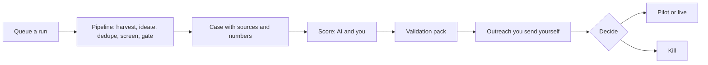

# PitchLab

PitchLab finds ideas for business-to-business (B2B) software services that are not generic, starting from real
complaints and demand it finds on the web. It turns the best ones into business cases backed by evidence: sources you
can click, numbers worked out by code from stated inputs, competitors that were checked, and a pitch. Then it helps
you test a case with real buyers. It writes a validation pack (a plan, prospects and outreach drafts that you send
yourself) and a landing page. It is built for one person, a solo founder or side-project builder, who wants a steady
supply of ideas worth pitching and an honest way to kill the weak ones. It runs as a private web dashboard plus a
background worker on your own computer.

## How it works



1. You queue a **run** from the dashboard (or the `gen` CLI). The worker searches the web for signs of pain, writes
   ideas, removes near-copies, ranks them and puts the survivors through a strict **gate** (generic? needs a licence?
   can it be automated? is there real evidence?).
2. Each idea that passes gets a full **case**. Its claims are checked against their sources, and the AI scores it.
3. You read and score the case, then generate a **validation pack**: prospects, emails to send, a checklist of go or
   kill targets, and a landing page.
4. You send the emails yourself, log what happened, and move the case to Pilot, Live or Killed.

Unfamiliar terms are explained in the [glossary](docs/glossary.md).

## What you need

- **Node.js 22.12 or newer** (the CLI library requires it).
- **An LLM gateway and one API key.** The worker speaks two APIs with the same key: the Anthropic Messages API for
  Claude models (including the server-side web search tool) and the OpenAI Chat Completions API for the non-Claude
  judge models and embeddings. Set `LLM_ANTHROPIC_BASE_URL` and `LLM_OPENAI_BASE_URL`; change the model for any
  stage with `MODEL_OVERRIDES` (see [architecture](docs/architecture.md#llm-router-and-cost-logging)).
- **A Postgres database** that the dashboard and the worker share. A free Supabase project works, or the local
  Postgres in `docker-compose.yml`. The CLI alone can use a built-in embedded database (PGlite) with no setup.
- Optional: `GITHUB_TOKEN`, `STACKEXCHANGE_KEY` (more signal sources) and `GOOGLE_PLACES_API_KEY` (a second prospect
  source).

## Quick start

```bash
git clone <repo-url> PitchLab
cd PitchLab
npm install
cp .env.example .env
```

Fill in `.env` (every variable is described in `.env.example` and in the [setup guide](docs/dashboard.md)):

- `DATABASE_URL`: your Postgres connection string. For Supabase use the session pooler string, and set
  `DATABASE_SSL_CA` ([steps](docs/dashboard.md#free-setup-supabase-database-app-on-your-pc-no-docker)).
- `LLM_API_KEY`, plus the two `LLM_*_BASE_URL` values for your gateway.
- `OWNER_PASSWORD_HASH`: run `npm run hash-password -w apps/web`, type a password of 12 or more characters, and
  paste it into `.env` as `OWNER_PASSWORD_HASH=<printed hash>`.
- `SESSION_SECRET`: paste the output of
  `node -e "console.log(require('crypto').randomBytes(32).toString('base64url'))"`.

Updating PitchLab: stop the web app, run `npm run gen -- runs` (or start the worker) once so the database is migrated,
then start the web app again. A web app on an older database shows errors on every page.

Then:

```bash
npm run gen -- runs   # first time only: creates the tables and the built-in example case
npm run web           # terminal 1: the dashboard at http://localhost:3000
npm run worker        # terminal 2: does the work you queue; leave it running
```

Log in. The **Progress** page tracks idea quality: it compares each benchmark pass with your baseline (see "Track idea quality" in the user guide). A guided tour starts on your first visit and walks the whole path on the example case. Replay it, or one
chapter, with **Take the tour** in the top bar. Before you can generate a validation pack, fill in your sender details
in Settings (anti-spam law requires them in every email).

## The CLI in brief

Everything the dashboard queues can also be run directly. Use `npm run gen -- <command>` from the repo root.

| Command | What it does |
|---|---|
| `gen run --seed open` | One full run across every sector. `--seed sector --sectors "A,B"`, `--seed lens --lenses id1,id2` or `--seed idea --file idea.txt` narrow it. `--ideas` (default 12) and `--advance` (default 3) set the counts. |
| `gen validate <case-slug>` | Builds the validation pack and writes it to `output/validation/<slug>/`. `--skip-prospects` skips the paid prospect search; `--refresh` regenerates the pack and landing page; `--redraft` rewrites drafts for prospects you have not contacted. |
| `gen runs` | Lists recent runs with status, stage, cost and cases. |
| `gen worker` | What `npm run worker` runs: executes queued runs, then queued validation packs. |

| `gen bench baseline` | Freezes today's idea-quality scorecard over your finished runs as the baseline to compare against. `--force` adds another. |
| `gen bench run` | Queues the 4 benchmark runs (about $12–28 in model calls); the worker executes them. |
| `gen bench report [passId]` | Prints the scorecard and writes it to `output/bench/`. `--recompute` freezes a new snapshot of a pass with today's data first. |

Also: `resume <runId>`, `export [slug] --all`, `outreach mark|status`, `prospects import`, `config set|get`.
`npm run gen -- <command> --help` shows every option.

## Costs

LLM spend is **notional**: PitchLab works it out from token counts and a price table
(`packages/core/src/config/prices.ts`). Your provider's invoice is the real figure.

| What | About |
|---|---|
| One run at the defaults (12 ideas, up to 3 cases) | $3–7. Real runs so far: $3.39–7.30 ([run notes](docs/runs/)). |
| One case for your own idea (or "Re-run as owner idea") | about $4 |
| One validation pack | $0.60–1.50, of which prospect search is about $0.45–0.60. "Skip new prospect search" (`--skip-prospects`) avoids that part. |
| Hosting | $0 with a free Supabase database and the app on your own computer |

Nothing spends money unless you press **Queue run** or **Generate validation pack**, or run a `gen` command
yourself. The tour never submits those forms.

## Safety stance

- **Never sends email.** PitchLab drafts outreach; you send it from your own mail program. Each prospect's address
  records where it was found (its CASL basis, after Canada's anti-spam law). Addresses with a weak or unknown basis
  are left out by default. Every draft ends with your identity and an unsubscribe line, and unsubscribes are
  suppressed for good. This is not legal advice.
- **Treats web text as untrusted.** Anything fetched from the web or written by a model is neutralised before it goes
  into a prompt, and it is always shown as plain text, never as HTML.
- **Fetches pages carefully.** Only public internet addresses are fetched (no local or private networks), and every
  redirect is checked again.
- **Verifies database TLS.** Remote database connections use verified TLS, and no setting turns the check off.
- **Keeps the dashboard private.** One owner, a hashed password, a signed session cookie, a rate-limited login,
  origin checks on every form, and no secrets in the browser. The dashboard never calls an LLM itself.

The reasons behind each rule are in [architecture](docs/architecture.md#security-model).

## Documentation

- [User guide](docs/user-guide.md): the workflow step by step, how to judge a case and when to kill it.
- [Setup and operations](docs/dashboard.md): database options, environment variables, phone access, troubleshooting.
- [Architecture](docs/architecture.md): layout, pipeline, worker, data model, security model, tests.
- [Glossary](docs/glossary.md): every term the app uses.
- [Known limits and follow-ups](docs/plan-1-followups.md).
- [Project log](docs/CONTEXT.md): the internal working log of decisions and runs.

## Development

```bash
npm test -w packages/core
npm test -w apps/web
npm run typecheck -w apps/web
npm run build -w apps/web          # needs the web variables in .env (dummy values are fine)
npm run check-bundle -w apps/web   # after the build: no secrets in the browser bundle
```

See [testing and merge gates](docs/architecture.md#testing-and-merge-gates).

## Status

A solo side project for a single owner. It runs locally today; hosting is planned. There is no licence file yet, so
all rights are reserved until one is added.
