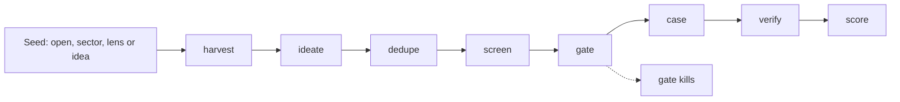
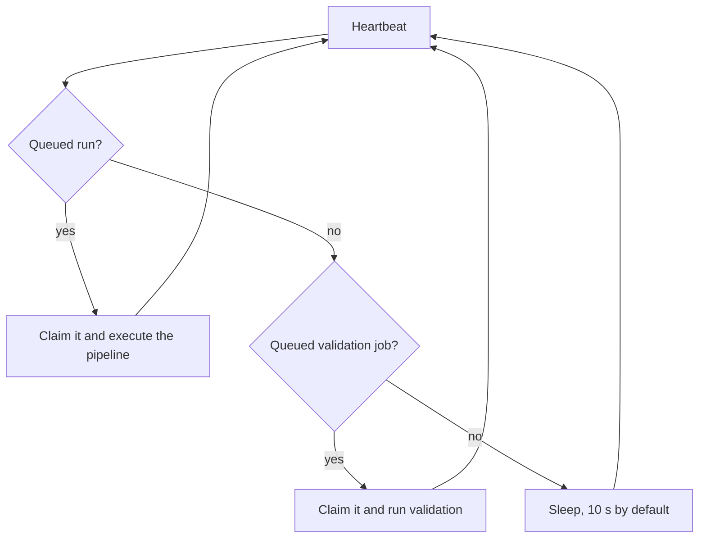

# PitchLab architecture

How PitchLab is put together and why. Read this before changing the code. For using the app, see the
[user guide](user-guide.md). For setup and operations, see the [setup guide](dashboard.md). Terms are defined in the
[glossary](glossary.md).

**Contents:** [Layout](#layout) · [Pipeline](#pipeline) · [Validation](#validation) ·
[Worker and job queue](#worker-and-job-queue) · [Data model](#data-model) ·
[LLM router and cost logging](#llm-router-and-cost-logging) · [Security model](#security-model) ·
[Testing and merge gates](#testing-and-merge-gates) · [Known limits](#known-limits)

## Layout

An npm workspaces monorepo, all TypeScript (ESM). The internal package names (`@bcg/*`) are older than the product
name.

```
packages/core/          @bcg/core: the library, the gen CLI and the worker
  src/pipeline/         the eight run stages and the orchestrator (run.ts)
  src/validation/       validation pack: docs, prospects, emails, drafts, landing page, export
  src/llm/              model router, Anthropic and OpenAI adapters, untrusted-text helpers
  src/tools/            page fetcher (SSRF guard), signal sources, error scrubbing, banned sources
  src/calc/             the case's numbers: inputs schema and the arithmetic (code, not the model)
  src/case/             case schema, review status, Markdown export
  src/dashboard/        web-safe queries the dashboard imports (board, runs, validation jobs, tour state)
  src/db/               Drizzle schema, client (PGlite or pg), migrations, TLS config, seed
  src/bench/            idea-quality benchmark: definitions, scorecard metrics, passes, Markdown report
  src/example/          the built-in example case (fixture, ensure, hide, reset)
  src/config/           env schema, model per stage, price table
  src/cli.ts, cli-program.ts, worker.ts
  prompts/              versioned prompt files (ideate.v7.md, gate.v2.md, ...)
  drizzle/              SQL migrations
  scripts/              db:copy (PGlite to Postgres) and diagnostic scripts
apps/web/               @bcg/web: the Next.js 16 dashboard (App Router, Server Actions, React 19)
  app/                  pages: board, leaderboard, progress, command, runs, settings, case page, login
  actions/              Server Actions (each checks origin and session first, validates with zod)
  components/           UI, including the tour (driver.js) and help tips
  lib/                  auth, env validation, DB pool, queries, tour chapters, glossary
  proxy.ts              route guard (Next 16's renamed middleware)
  scripts/              hash-password, acceptance, check-bundle
docs/                   these docs, run notes (docs/runs), design specs and plans (docs/superpowers)
docker-compose.yml      optional local Postgres with pgvector (127.0.0.1:5433)
```

**Purpose of each workspace:**

- **`packages/core`** holds everything that spends money or touches the outside world: model calls, web fetching,
  the pipeline and validation, plus the database schema. `npm run gen` runs its CLI with `tsx`. `npm run worker`
  is `gen worker`. Any `gen` command first migrates the database it opens, seeds defaults and makes sure the example
  case exists (unless you hid it).
- **`apps/web`** is the private dashboard. It reads and writes the shared Postgres database and queues work, but
  **never calls an LLM or fetches the web**. It imports only web-safe core modules (`src/dashboard/*`, schemas,
  pure helpers). `apps/web/test/core-imports.test.ts` fails if any import reaches the router, adapters, page fetcher,
  env loader, `db/client`, PGlite or the CLI.

The database is Postgres with the pgvector extension. The CLI can use embedded PGlite (`pglite://.data/pglite`, the
default) when it runs alone. The dashboard and the worker must share a real Postgres, because PGlite allows only one
process.

## Pipeline

A **run** is one pass through eight stages, defined in `packages/core/src/pipeline/types.ts` (`STAGES`) and
executed by `pipeline/run.ts`.



| Stage | Purpose | Inputs | Outputs | Model stage(s) |
|---|---|---|---|---|
| `harvest` | Find real pain signals: web research (one call per sector for open and sector seeds, one call for lens and idea seeds), plus the free tech-forum sources (Hacker News, Stack Exchange, GitHub, WordPress.org) for lens seeds and when a software-adjacent sector is chosen. Then extract quotes and tag each one's voice (operator, neutral, vendor). | Run config (seed, sectors, lenses, market) | `signals` rows; `{ signalIds }` | `harvest` (research with web search), `extract` |
| `ideate` | Write ideas from the signals through lenses. Each idea names its buyer, mechanism, known incumbents and the functional gap they leave. Past gate kills ("already sold") and ideas with cases ("already covered") are shown so they are not repeated. An owner idea is structured instead. | Signals; past kills and cases | `ideas` rows (`candidate`); `{ ideaIds }` | `ideate` |
| `dedupe` | Embed each idea and mark near-copies (cosine ≥ 0.88 by default) of an earlier idea or of one already kept this run. Owner ideas are always kept. | Idea ids | Embeddings; `duplicate` status; `{ ideaIds }` | `embed` |
| `screen` | Score ideas on 7 criteria plus novelty (counted twice). Keep the top `advanceCount`, at most 2 per mechanism, skipping near-twins (> 0.8), copies of ideas with cases (≥ 0.82) and ideas close to past gate kills (≥ 0.75). | Idea ids | `advanced` or `screened_out`; `{ ideaIds }` | `screen` |
| `gate` | Strict pass/fail. A different model family from ideate judges `generic`, `regulation`, `control`, `autonomy` and `reachability` after researching competitors. `evidence` is a code rule: at least `minSignals` (3) independent operator or neutral sources, counted by domain, with up to 2 threads per community platform. Failing any check kills a generated idea; for an owner idea the gate only advises. | Idea ids | `gate_verdicts` rows; `gated_out` or `advanced`; `{ passed, advisory }` | `competitors` (research), `gate` |
| `case` | Research and write the full case: summary, evidence, numbers inputs, competitors and levels table, pitch. The model supplies inputs with a source or a named assumption; `src/calc/numbers.ts` does all the arithmetic and records the formulas. Claims citing banned sources become assumptions. | Passed idea ids | `cases` and `claims` rows; `{ caseIds }` | `case` (research and write) |
| `verify` | Fetch every cited URL (GitHub issues through the API) and judge whether it supports the claim. Confident: `verified` or `unsupported`. Unsure (confidence 0.3 to 0.6) or an unconfirmable competitor fact: `needs_review`. Unreadable page (blocked, or rendered by JavaScript): `unreachable`. | Case ids | Claim flags and review notes | `verify` |
| `score` | AI scores for 7 criteria (1–5 with a note). Evidence strength is capped by the share of verified claims (< 50%: at most 2; < 80%: at most 3). | Case ids | `scores` rows (`by = ai`) | `score` |

**Orchestration rules** (`pipeline/run.ts`):

- Each stage's output is stored in `run_stages`. Calling `executeRun` again on a failed run (`gen resume <runId>`, or
  **Resume** in the dashboard) reuses the stages already done and continues from the failed one.
- Every stage is idempotent per item: a re-run replaces its own rows, and multi-row writes go in one transaction.
- When a stage outputs nothing (no signals, no ideas, nothing passed the gate), the remaining stages are marked done
  and skipped. An owner idea continues even with no signals, because it always gets a case.
- Stored errors are scrubbed of credentials (`tools/scrub.ts`) before they reach the database or the dashboard.
- Run defaults (`defaultRunConfig`): market `ca-us`, 12 ideas, 3 advanced, 3 searches per sector, 3 minimum signals,
  dedupe threshold 0.88.

## Validation

`packages/core/src/validation/run.ts` builds the validation pack for one case in six steps (`VALIDATION_STEPS`). The
dashboard's **Generate validation pack** button and `gen validate <slug>` both call it. Each step is idempotent on
its own, and finished steps stay saved whatever happens later.

| Step | What it does | Model stage |
|---|---|---|
| `pack` | MVP spec, pilot plan, interview kit and the go/kill checklist (targets for emails sent, positive replies, meetings, interviews, landing conversion). Kept if it exists, unless `--refresh`. | `pack` |
| `prospects` | Find businesses that fit the buyer (web research by default; Google Places with `--source places`) and upsert one row per case and domain. Skipped with `--skip-prospects`. | `prospect` (research), `extract` |
| `emails` | For prospects without an email, fetch their own site and pick an address. An address found on the prospect's own domain gets the CASL basis `self_published`. No model call. | none |
| `drafts` | A cold email and two follow-ups per prospect with a usable email (`self_published` only, unless `--include-weak`; never suppressed, unsubscribed or not interested). Code appends the sender footer. Contacted prospects keep their drafts as the record of what was sent. | `outreach` |
| `landing` | Landing page copy and a static HTML page. Kept if it exists, unless `--refresh`. | `landing` |
| `export` | Writes `pack.md`, `prospects.csv`, `outreach.csv`, `outreach-drafts.md` and `landing/index.html` to `output/validation/<slug>/`. | none |

Failure handling: a `pack` failure stops the job. A failure in the outreach chain (prospects, emails, drafts) skips
the rest of that chain, but the landing page and the export still run, so you get what was made. Any failure gives
exit code 1. Finding 0 prospects is a warning, not a failure.

The checklist (`validation/checklist.ts`) compares each target with tracked data: `sent` events, positive replies,
meetings, `note` events starting "interview:", and landing submits ÷ visits. A target passes when the value reaches a
positive threshold.

## Worker and job queue

The worker (`packages/core/src/worker.ts`, started by `npm run worker`) is a loop over two queues in the database:
`runs` with status `queued` (from the Runs screen or "Re-run as owner idea") and `validation_jobs` with status
`queued` (from the Validate tab).



- **Runs first, then validation jobs.** A validation job is claimed only when no run is queued.
- **Claiming** is one `UPDATE … WHERE id = (SELECT … FOR UPDATE SKIP LOCKED)` statement, so two workers never take
  the same item.
- **Heartbeat:** the worker writes its status (which keys are set, as booleans, and the resolved model per stage)
  before each claim and every interval while it works. The dashboard shows "not seen" after 60 seconds of silence.
- **Queue limits:** at most 3 queued runs, and at most 3 queued validation jobs. Only one queued or running job per
  case; a `running` job older than 2 hours counts as dead, so a new one may be queued. Inserts are serialised with a
  transaction-scoped advisory lock. Validation is refused for the example case or when the sender identity is
  incomplete (`dashboard/validation-jobs.ts`).
- **Re-validation:** a claimed run's stored config is checked again with zod. An invalid one is failed, not executed.
- **Stopping:** Ctrl+C finishes the current item and exits. A second Ctrl+C exits at once.
- **No leases yet.** A worker killed mid-run leaves the run `running` until `gen resume <runId>`, and a validation job
  `running` until the 2-hour stale rule allows a new one. Leases are planned with hosting.
- `gen run` and `gen validate` run in the foreground without the queue. `gen run` creates its run as `running`, so a
  worker never claims it.

## Benchmark

`packages/core/src/bench/` measures idea quality from stored rows only (no model calls). `definitions.ts` holds the
immutable `bench-v1` seeds and the 13 metric definitions; `scorecard.ts` computes a scorecard over a set of runs
(example data excluded, at most 200 runs and 3000 ideas, with a note when trimmed); `passes.ts` freezes baselines,
queues passes and finalises them. A snapshot is stored once in `benchmark_passes` (kind `baseline`, `pass` or
`recompute`; status `running`, `complete` or `incomplete`) and is never recomputed in place: `gen bench report
--recompute` adds a new `recompute` row.

- **Queueing:** `queueBenchmarkPass` runs in one transaction under the queue advisory lock. It refuses when a pass is
  running or any run is queued or running, then inserts the pass and its 4 runs, each with `runs.benchmark_pass_id`
  set. The dashboard's Progress page and `gen bench run` both call it.
- **Finalise hook:** the worker calls `finalizeBenchmarkPasses` after each item. When every run of a running pass has
  finished, the pass is frozen with metrics over all its runs: `complete`, or `incomplete` if any run failed. The hook
  is idempotent and a failure in it never stops the worker.
- **Dashboard:** `apps/web` imports these modules as web-safe core code; the Progress page only reads passes and queues
  one through `runBenchmarkAction`.

## Data model

Drizzle schema in `packages/core/src/db/schema.ts`; migrations in `packages/core/drizzle/`. Grouped by purpose:

| Purpose | Tables |
|---|---|
| Configuration | `markets` (countries, sectors), `lenses` (idea patterns), `settings` (key/value JSON: sender identity, landing settings, worker heartbeat, tour state, example hidden flag) |
| Runs | `runs` (config, status, current stage, notional cost), `run_stages` (output and status per stage) |
| Ideas | `signals` (quote, URL, source, voice), `ideas` (text, mechanism, buyer type, incumbents, gap, embedding, screen scores, status), `gate_verdicts` (per check: pass, reasoning, sources, model) |
| Cases | `cases` (slug, stage, sections JSON, kill reason, gate advisory, `is_example`), `claims` (text, source, quote, verification flag, review note), `scores` (per criterion, `ai` or `owner`) |
| Owner decisions | `stage_events` (every stage move: move, kill or overturn, with note) |
| Validation | `validation_packs`, `validation_jobs` (queue: options, status, steps, cost), `landing_pages`, `landing_events` (visits and submits, for the future hosted form) |
| Outreach | `prospects` (website, domain, email and where it was found, CASL basis, status), `outreach_drafts` (cold, followup1, followup2), `outreach_events` (sent, replied, positive, meeting, not interested, unsubscribe, note), `suppressions` (unsubscribed addresses, lowercased) |
| Benchmark | `benchmark_passes` (version, label, kind, status, run ids, frozen scorecard JSON, source pass); `runs.benchmark_pass_id` links a run to its pass |
| Cost logging | `llm_calls` (every model attempt: stage, model, tokens, searches, notional cost, latency, prompt version, error), `data_calls` (calls to data sources such as the free forums and Google Places, with cost) |

Embeddings are `vector(1536)` columns (pgvector). Enums such as `run_status`, `case_stage`, `claim_verified`,
`casl_basis` and `prospect_status` are Postgres enums, defined at the top of the schema file.

## LLM router and cost logging

`packages/core/src/llm/router.ts` is the only way the code calls a model. Callers name a **model stage**, not a
model. The router picks the model, the adapter and the limits.

- **Model per stage** (`config/models.ts`, `DEFAULT_MODELS`): `extract`, `screen` on a small Claude model; `harvest`,
  `competitors`, `verify`, `prospect`, `outreach`, `landing` on a mid Claude model; `ideate`, `case`, `pack` on the
  largest Claude model; `gate` on a GPT model; `score` on a Gemini model; `embed` on an OpenAI embedding model.
  Override any of them with `MODEL_OVERRIDES` (JSON, stage to model name).
- **Rules checked at start-up** (`validateModelConfig`): `gate` and `score` must be a different model family from
  `ideate`, so a model never grades its own ideas. The stages that search the web (`harvest`, `competitors`, `case`,
  `prospect`) must be Claude models, because they use Anthropic's server-side web search tool.
- **Adapters:** Claude models go through the Anthropic Messages API (`LLM_ANTHROPIC_BASE_URL`); every other model goes
  through the OpenAI Chat Completions API (`LLM_OPENAI_BASE_URL`). Both use `LLM_API_KEY`. The Anthropic adapter
  handles gateway quirks: no forced tool choice on some models, a cache breakpoint on long prompts, and one
  non-streaming retry on a streaming 403.
- **Call types:** `text`, `structured` (JSON validated with zod; up to 2 re-asks with the validation issues),
  `research` (web search, capped searches per call) and `embed`.
- **Limits:** a shared concurrency limit (`LLM_MAX_CONCURRENCY`, default 4) and up to 5 attempts with backoff.
- **Cost logging:** every attempt, including failed ones, writes an `llm_calls` row. Its cost comes from
  `config/prices.ts`: USD per million input and output tokens per model, plus $10 per 1,000 web searches. Run
  calls also add to `runs.cost_usd`. Validation calls carry no run id, so a validation job's cost is the spend logged
  between its start and finish. All figures are **notional**: they come from a price table you can edit, not from
  your bill. A model missing from the table is logged at $0 with a warning.
- **Prompts** are versioned files in `packages/core/prompts/`. Every stored verdict, case and call records its
  prompt version, so results can be traced to the prompt that made them.

## Security model

Each rule below has a reason. Keep the reason in mind before relaxing a rule.

| Rule | Where | Why |
|---|---|---|
| **SSRF guard:** fetch only `http(s)` with GET; resolve DNS and allow only globally routable unicast addresses; pin the connection to the checked address; re-check every redirect (at most 5), and refuse redirects to IP literals; cap size and time. | `tools/fetch-page.ts` | The pipeline fetches URLs that came from web pages and model output. Without the guard, a hostile page could make the worker reach your router, cloud metadata or local services. Pinning closes DNS rebinding. |
| **Banned and never-fetch sources,** enforced in code and failing closed. | `tools/banned-sources.ts` | Some sites forbid automated use in their terms (Reddit, LinkedIn, G2 and others). A pilot site you have no permission for (`--pilot-site`) is never fetched, listed, drafted for or exported. |
| **Untrusted text handling:** web and model text is wrapped in tags with every angle bracket replaced and invisible or bidirectional characters removed; fields are length-capped. | `llm/untrusted.ts` | Prompt injection: a page could say "ignore your instructions". Wrapping makes it data that cannot close the tag, and the prompts say so. |
| **No HTML from data:** all case, LLM and web text renders as React text, never `dangerouslySetInnerHTML`. The Markdown export escapes HTML and link syntax. Tour text comes only from string literals. | `apps/web`, `case/export-markdown.ts`, `apps/web/test/guards.test.ts` | Stored text came from the open web. Rendering it as HTML would allow script injection into your dashboard. driver.js renders tour text as HTML, so it never receives data. |
| **Never sends email.** PitchLab only drafts. You send from your own mail program and log the outcome. | `validation/outreach.ts` (drafts only, no mail code) | Sending cold email from Canada brings CASL duties (consent, identification, unsubscribe handling). Keeping a person in the loop keeps those duties simple and visible. |
| **CASL basis and footers:** every prospect email stores its source URL, capture time and basis; only `self_published` addresses are drafted by default; every draft ends with your name, mailing address, another contact and an unsubscribe line; unsubscribes go to `suppressions` and are never exported again. | `validation/prospects.ts`, `validation/emails.ts`, `validation/outreach.ts` | CASL allows emailing without prior consent only if the person published the address themselves and the message relates to their role. It also requires identification and a working unsubscribe. This is not legal advice. |
| **Spending needs a deliberate press.** Only "Queue run", "Generate validation pack" or a `gen` command spends money. The tour never submits forms. The example case cannot be validated. | `apps/web/components`, `dashboard/validation-jobs.ts` | Model calls cost real money. Nothing should spend it by accident, while browsing or during the tour. |
| **Database TLS verification:** `DATABASE_SSL` is `auto` (plain only for localhost and `*.railway.internal`, verified TLS for any other host), `verify` or `disable`. No mode skips certificate checks. TLS parameters in the URL are stripped. A CA file comes from `DATABASE_SSL_CA`. | `db/pg-config.ts`; guard tests fail on `rejectUnauthorized: false` | The database holds everything. A connection that does not verify the certificate can be intercepted. URL parameters such as `sslmode` could silently override the setting, so they are removed. |
| **Auth, layer 1:** a route guard redirects any request without a valid session to `/login`. | `apps/web/proxy.ts` | A single owner means no public pages at all, so the default is deny. |
| **Auth, layer 2:** pages and route handlers call `requireOwner()`; every Server Action calls `requireOwnerAction()` first (origin check, then session) and validates input with zod. | `apps/web/lib/auth/require-owner.ts`, `apps/web/actions/*` | Defence in depth if the guard's matcher ever misses a path. The origin check blocks cross-site form posts (CSRF), including a missing or `null` Origin, which Next.js only warns about. A test checks that every action export requires a session. |
| **Password and session:** scrypt hash (N=2^15, random salt, constant-time compare); signed HS256 session cookie (jose), httpOnly, SameSite=Lax, `__Host-` and Secure in production, 7 days; rotate `SESSION_SECRET` to log out everywhere. | `apps/web/lib/auth/password.ts`, `session.ts` | The password is never stored, and a stolen database does not reveal it cheaply. The app refuses to start with an insecure cookie in production unless you explicitly allow it for localhost. |
| **Login rate limit:** 5 failures per client and 30 overall per 10 minutes, counted before the slow password check; at most 2 password checks at once. | `apps/web/lib/auth/rate-limit.ts`, `semaphore.ts`, `actions/auth.ts` | Stops password guessing, and stops a burst of logins from tying up the CPU with scrypt. It is in memory, so it resets on restart (see known limits). |
| **No secrets in the browser:** no `NEXT_PUBLIC_*` variables; `check-bundle` searches the built browser files for every secret value and for server-only markers. The dashboard never holds the LLM key. | `apps/web/scripts/check-bundle.mjs` | A secret shipped to the browser is public. Keeping model calls in the worker means the web app has nothing worth stealing beyond the database. |
| **Error scrubbing:** errors stored in the database or shown in the dashboard have keys, tokens and auth headers redacted. | `tools/scrub.ts` | Provider errors sometimes echo request headers. |
| **Security headers:** no framing, `nosniff`, same-origin referrer, `noindex`; HSTS in production. | `apps/web/lib/security-headers.ts` | Clickjacking protection, and keeping a private app out of search engines. |

## Testing and merge gates

- **Tests:** Vitest in both workspaces. Core tests run against in-memory PGlite with mocked routers and fetchers, so
  they need no network or keys. Web tests cover actions, auth, queries, pages and components (jsdom), plus static
  guards: no HTML from data, every tour anchor exists, the glossary matches the in-app tips, web-safe core imports,
  and every relative link in these docs resolves (`apps/web/test/docs-links.test.ts`).
- **Real Postgres (optional):** set `TEST_DATABASE_URL` to a **throwaway** database to run the tests that need real
  Postgres (for example, concurrent worker claims with `SKIP LOCKED`). They are skipped otherwise.
- **Merge gates.** All must pass before a branch merges:

  ```bash
  set -o pipefail
  npm test -w packages/core
  npm test -w apps/web
  npm run typecheck -w apps/web
  npm run build -w apps/web          # needs the web env; dummy values are fine
  npm run check-bundle -w apps/web   # after the build, with the same env
  ```

  Also: a secret scan of the history finds no tokens, and no `.env`, `.data`, `output`, `.next`, `.crt` or `.pem`
  files are tracked.
- **Acceptance (manual):** `npm run acceptance -w apps/web` drives a running production build like a browser
  without JavaScript and undoes its writes. See the [setup guide](dashboard.md#acceptance-check-after-a-change-or-on-a-new-machine).
- Node 22.12 or newer is required (commander 15 needs it). `package.json` does not pin `engines` yet.

## Known limits

The full, current list is in [plan-1-followups.md](plan-1-followups.md). The main ones:

- **Not hosted yet.** The app runs on your computer. Hosting (Railway), continuous runs, spend caps, worker leases and
  learning from your scores are planned.
- **The LLM setup assumes one gateway** that serves Claude models in the Anthropic format and GPT, Gemini and
  embedding models in the OpenAI format, with one key. Using separate providers needs a code change.
- **No leases:** a killed worker leaves its item `running` (see [the worker](#worker-and-job-queue)).
- **The login rate limiter is in memory** and per instance. A hosted deployment needs a shared store.
- **Costs are notional:** cache tokens are priced as plain input, and some in-adapter retries are not logged.
- **Landing pages are files only:** publishing them and collecting sign-ups need the hosted form endpoint.
- **Prospect yield is uneven:** web research often finds fewer prospects than asked, with loose size fit. No
  email-verification service is integrated.
- **The gate counts evidence before verification:** a quote that later fails verification still counted toward the
  evidence rule.
- **Model claims stay claims:** an idea's incumbents and functional gap are the model's knowledge. Only the gate's
  competitor research tests them.
